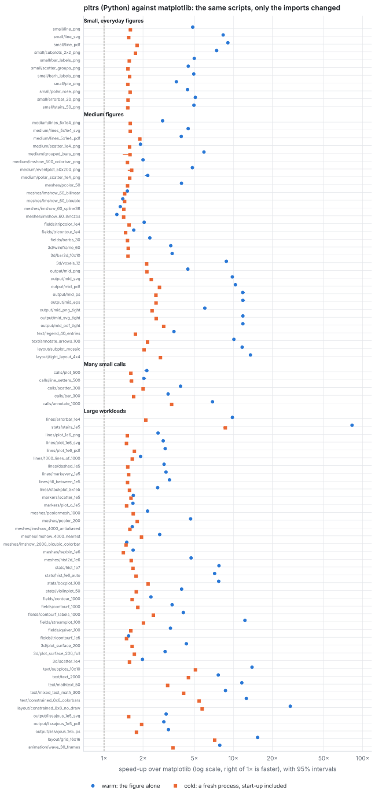
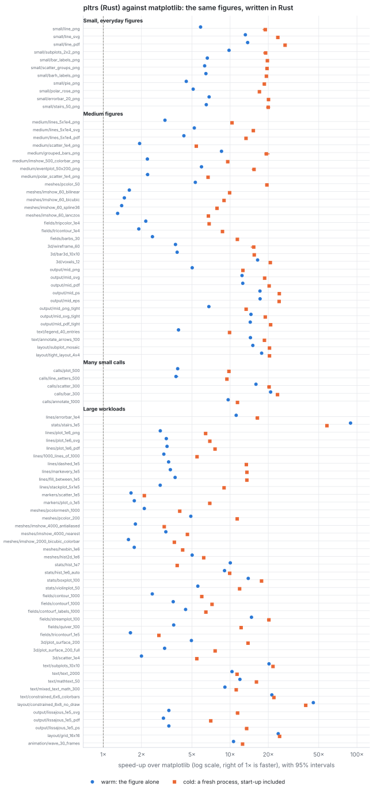
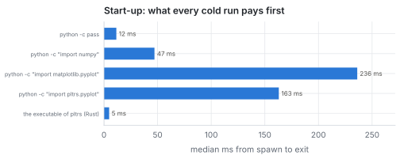

# Benchmarks of matplotlib, pltrs (Python) and pltrs (Rust)

<!-- `cargo xtask bench --report` (xtask/src/bench/report) generates this file from results.json. Do not edit it by hand. -->

This report times matplotlib 3.11.2 against both faces of pltrs on 91 workloads. pltrs (Python) runs the same Python scripts as matplotlib. Only the imports change. pltrs (Rust) draws the same figures from Rust. A speed-up such as "4.2× faster" means that matplotlib took 4.2 times as long.

The harness measured the numbers on 2026-11-10 at commit `487a7e6cd9-dirty`, on a Mac14,5. [Machine and versions](#machine-and-versions) describes the machine and the software. [`results.json`](results.json) holds every time of every run. pltrs (Rust) drew the charts from that file, and `cargo xtask bench --rewrite-report` draws them again.

## Summary

The report makes two claims and measures each claim separately:

* pltrs (Python) against matplotlib runs one Python program with two libraries.
* pltrs (Rust) against matplotlib compares a Rust program and a Python program that draw the same figure.

Each claim has a warm number and a cold number. A warm number times the figure alone, in a running program. A cold number times a whole program in a fresh process, including start-up. A workload counts as faster or slower only if the 95% confidence interval of its speed-up excludes 1. Otherwise, it is within the noise. The typical speed-up of a tier is the geometric mean over its workloads.

### pltrs (Python) as a drop-in replacement for matplotlib

Both columns run the same scripts with the same interpreter and the same numpy build. The interpreter is Python 3.14.8 at `~/.worktrees/plt-rs/mac3/target/uv/python/cpython-3.14.8-macos-aarch64-none/bin/python3.14`. The numpy build is 2.5.4, with the core library digest `c40660ca121819cf`. Only the imports differ. The scripts for pltrs (Python) say `import pltrs.pyplot as plt` in place of `import matplotlib.pyplot as plt`.

| tier | workloads | warm, faster / within noise / slower | warm, typical speed-up | cold, faster / within noise / slower | cold, typical speed-up |
|---|---:|---:|---:|---:|---:|
| Small, everyday figures | 11 | 11 / 0 / 0 | 5.4× faster | 11 / 0 / 0 | 1.59× faster |
| Medium figures | 31 | 31 / 0 / 0 | 4.3× faster | 31 / 0 / 0 | 1.84× faster |
| Many small calls | 5 | 5 / 0 / 0 | 3.3× faster | 5 / 0 / 0 | 1.97× faster |
| Large workloads | 42 | 42 / 0 / 0 | 4.4× faster | 42 / 0 / 0 | 2.1× faster |
| **all workloads** | 89 | 89 / 0 / 0 | 4.4× faster | 89 / 0 / 0 | 1.94× faster |



* pltrs (Python) is faster warm on all 89 workloads. The smallest speed-ups are `meshes/imshow_60_lanczos` (1.25× faster [1.25, 1.26]), `meshes/imshow_60_spline36` (1.33× faster [1.33, 1.34]), `meshes/imshow_60_bicubic` (1.40× faster [1.39, 1.40]).
* pltrs (Python) is faster cold on all 89 workloads. The smallest speed-ups are `meshes/hexbin_1e6` (1.41× faster [1.38, 1.42]), `meshes/imshow_60_lanczos` (1.42× faster [1.41, 1.42]), `meshes/imshow_60_spline36` (1.42× faster [1.41, 1.44]).

pltrs (Python) runs all 90 workloads that matplotlib runs.
 The correctness guard found that pltrs (Python) draws a different figure from matplotlib in `fields/contourf_labels_1000`. The tallies leave out these workloads.
 The correctness guard found that pltrs (Rust) draws a different figure from matplotlib in `fields/contourf_labels_1000`. The tallies leave out these workloads.

### pltrs (Rust) against matplotlib

This claim compares programs in two languages that draw the same figure. A cold run of pltrs (Rust) starts a native executable. A cold run of matplotlib starts the Python interpreter and imports numpy and pyplot. On this machine, these steps alone take 236 ms. The warm numbers do not include start-up on either side.

| tier | workloads | warm, faster / within noise / slower | warm, typical speed-up | cold, faster / within noise / slower | cold, typical speed-up |
|---|---:|---:|---:|---:|---:|
| Small, everyday figures | 11 | 11 / 0 / 0 | 7.2× faster | 11 / 0 / 0 | 20× faster |
| Medium figures | 31 | 31 / 0 / 0 | 5.1× faster | 31 / 0 / 0 | 13× faster |
| Many small calls | 5 | 5 / 0 / 0 | 8.6× faster | 5 / 0 / 0 | 14× faster |
| Large workloads | 42 | 42 / 0 / 0 | 5.1× faster | 42 / 0 / 0 | 9.4× faster |
| **all workloads** | 89 | 89 / 0 / 0 | 5.5× faster | 89 / 0 / 0 | 12× faster |



* pltrs (Rust) is faster warm on all 89 workloads. The smallest speed-ups are `meshes/imshow_60_lanczos` (1.30× faster [1.30, 1.30]), `meshes/imshow_60_spline36` (1.40× faster [1.39, 1.41]), `meshes/imshow_60_bicubic` (1.47× faster [1.46, 1.47]).
* pltrs (Rust) is faster cold on all 89 workloads. The smallest speed-ups are `markers/scatter_1e5` (2.1× faster [2.1, 2.1]), `fields/tricontourf_1e5` (2.7× faster [2.7, 2.8]), `meshes/imshow_4000_antialiased` (3.0× faster [3.0, 3.0]).

### Start-up

On this machine, a fresh interpreter takes 11.5 ms to start and exit. An interpreter that imports numpy takes 47.1 ms. An interpreter that imports `matplotlib.pyplot` takes 236 ms. An interpreter that imports `pltrs.pyplot` takes 163 ms. The executable of pltrs (Rust) starts and exits in 4.81 ms. [Start-up and imports](#start-up-and-imports) gives the details.



### Peak memory

Each ratio compares the peak resident memory of a cold run with the peak of matplotlib on the same workload.

* A cold run of pltrs (Python) typically peaks at 0.93 times the memory of matplotlib, and at 0.31 to 1.21 times over all 90 workloads.
* A cold run of pltrs (Rust) typically peaks at 0.27 times the memory of matplotlib, and at 0.10 to 0.80 times over all 90 workloads.

The memory of both Python columns includes the interpreter and numpy. [Start-up and imports](#start-up-and-imports) measures these alone. pltrs (Rust) uses neither.

### Where the margins are thin

The table lists each speed-up below 1.50× faster and each slowdown. These workloads fall in three groups.

The first group is figures of millions of values. Examples are the lines of 10⁶ points, the 4000 × 4000 images, and the 10⁶ and 10⁷ samples of a hexbin and a histogram. Both libraries transform or map every value in compiled code. pltrs also copies the values out of numpy, and it makes and frees buffers of tens of megabytes for every figure. The C library returns that memory to the system after each draw. Thus the next draw faults it in again, 4 KiB at a time. In contrast, numpy backs its arrays with 2 MiB pages.

The second group enlarges a small image with a large kernel. Both libraries resample the image with the same Agg filters. Much of the remaining time goes to PNG compression. There, the Pillow of matplotlib uses zlib-ng, which is faster than the zlib-like encoder of pltrs ([Same work](#same-work)).

The third group is scatters in which every marker has a different size. Both libraries stroke and fill each marker with the same Agg algorithms.

Cold runs add the start-up of the interpreter and numpy to both sides.

| workload | implementation | run | speed-up [95% interval] |
|---|---|---|---:|
| `meshes/imshow_60_bicubic` | pltrs (Python) | warm | 1.40× faster [1.39, 1.40] |
| `meshes/imshow_60_spline36` | pltrs (Python) | warm | 1.33× faster [1.33, 1.34] |
| `meshes/imshow_60_lanczos` | pltrs (Python) | warm | 1.25× faster [1.25, 1.26] |
| `meshes/imshow_2000_bicubic_colorbar` | pltrs (Python) | warm | 1.50× faster [1.49, 1.50] |
| `lines/plot_1e6_svg` | pltrs (Python) | cold | 1.49× faster [1.48, 1.51] |
| `markers/plot_o_1e5` | pltrs (Python) | cold | 1.49× faster [1.46, 1.54] |
| `meshes/imshow_60_bilinear` | pltrs (Python) | cold | 1.44× faster [1.43, 1.46] |
| `meshes/imshow_60_bicubic` | pltrs (Python) | cold | 1.44× faster [1.43, 1.46] |
| `meshes/imshow_60_spline36` | pltrs (Python) | cold | 1.42× faster [1.41, 1.44] |
| `meshes/imshow_60_lanczos` | pltrs (Python) | cold | 1.42× faster [1.41, 1.42] |
| `meshes/imshow_2000_bicubic_colorbar` | pltrs (Python) | cold | 1.48× faster [1.47, 1.49] |
| `meshes/hexbin_1e6` | pltrs (Python) | cold | 1.41× faster [1.38, 1.42] |
| `fields/tricontourf_1e5` | pltrs (Python) | cold | 1.49× faster [1.48, 1.50] |
| `fields/tricontour_1e4` | pltrs (Python) | cold | 1.47× faster [1.46, 1.48] |
| `meshes/imshow_60_bicubic` | pltrs (Rust) | warm | 1.47× faster [1.46, 1.47] |
| `meshes/imshow_60_spline36` | pltrs (Rust) | warm | 1.40× faster [1.39, 1.41] |
| `meshes/imshow_60_lanczos` | pltrs (Rust) | warm | 1.30× faster [1.30, 1.30] |

## How the comparison is kept fair

### Same output

Each workload makes one figure. Its Python version is a script for matplotlib in [`benchmarks/python`](../python). pltrs (Python) runs a copy of that script, in which every `import matplotlib...` reads `import pltrs...`. Nothing else changes. The Rust version of the workload is in [`xtask/src/bench/workloads`](../../xtask/src/bench/workloads). Both versions make the same data with the same seeded generator, SplitMix64. The Python version draws the values with numpy.

All three implementations draw in the matplotlib look with the default rcParams of matplotlib. These set the same figure size, 100 dpi, DejaVu Sans, and the default hinting and antialiasing. pltrs (Python) draws in the modern look by default, so it runs with `PLTRS_LOOK=matplotlib`. The Rust workloads select the matplotlib look in code. matplotlib and pltrs read their configuration from empty directories of the benchmark (`MPLCONFIGDIR`, `PLTRSCONFIGDIR`). Thus no rc file of the user changes a default.

Before the harness times a workload, the [correctness guard](#correctness-guard) makes each implementation save its figure. The guard compares each figure with the figure of matplotlib:

* The PNG pixels must be within an RMS difference of 2 of the pixels of matplotlib, on a scale of 0 to 255. For an animation, every frame must pass this check.
* An SVG, PDF, PostScript or EPS document must hold the same drawing operations as the document of matplotlib, with every number within 0.01. The guard reduces both documents to their drawing operations. It resolves every reference, such as glyphs, markers, clip paths, fonts and images. The vector tests of the conformance spec do the same (`pltrs_spec::figures::vector`). The guard ignores ids, object numbers, metadata and compression.

If a figure fails a check, the harness times it but marks it with †. The summary leaves it out.

### Same work

* **Metadata.** All three implementations write their default metadata. PDF, PostScript and SVG documents hold the creator, the producer and the date. PNG files hold the name of the software. Each side makes SVG ids from the default random salt.
* **PNG compression.** Both libraries compress at the default zlib level 6. They pick the filter of each row adaptively, by the smallest sum of absolute differences. matplotlib saves PNG through Pillow 12.3.0, which uses zlib-ng 2.3.3. At level 6, zlib-ng is faster than zlib and compresses a little less. The encoder of pltrs works as zlib does. Thus its files are a few percent smaller, and it takes more time. The tables give the size of every document.
* **PDF compression.** Each side compresses streams at `pdf.compression` 6. matplotlib uses Python's zlib 1.2.12. pltrs uses its own DEFLATE encoder, which works as zlib does, with hash chains and lazy matching.
* **Paths.** Simplification and snapping keep their defaults on every side. The `output/lissajous_1e5_*` workloads turn off `path.simplify` on every side. Thus each of the 10⁵ segments reaches the document.
* **Drawing without output.** `layout/constrained_8x8_no_draw` runs `fig.draw_without_rendering()` in Python and `Figure::draw_without_rendering` in Rust. In both, every artist draws to a renderer that writes no output.
* **Caches.** A warm run must not profit from a cache that only one side keeps. matplotlib keeps one text cache from one figure to the next. This cache holds the last 50 parsed formulas (`MathTextParser._parse_cached`). matplotlib stores its text metrics with the renderer of each figure. The text engine of pltrs (Rust) keeps every line, formula and glyph outline that it laid out. Before every warm run, the harness clears these caches on all three sides, outside the clock. Fonts stay loaded on every side, because matplotlib also keeps its `FT2Font` objects and its font list.

### Same conditions

* **Data outside the clock.** Each script makes its data when Python imports it. Each Rust workload makes its data before its first run. In Python, a warm run times `draw()` and `savefig` to memory. In Rust, a warm run times building the figure and saving it to memory. A cold run times the whole program, which includes making the data. numpy makes the data in Python, and plain Rust makes it in pltrs (Rust). Thus this part also differs by language.
* **Teardown outside the clock.** After the clock stops, Python closes the figure with `plt.close`, and Rust drops it. The garbage collector of Python stays on, as in a user program. It runs a full collection before each warm run, outside the clock. Thus no run pays for the garbage of the run before.
* **Warm runs in turns.** Each Python column runs its script in a long-lived process (`bench.py serve`). pltrs (Rust) runs in the harness. After one warm-up run each, the three implementations take turns. Each round has one timed run of each implementation, and the order rotates from round to round. Thus a change in the load or clock speed of the machine affects all three equally. Each workload runs at least 10 and at most 50 rounds. After 10 rounds, the harness stops when the slowest implementation has run for 1 s in total.
* **Cold runs in turns.** Each cold run is a fresh process. Python runs `python script.py out.png`, and pltrs (Rust) runs its executable (`cargo xtask bench --child cold NAME out.png`). The three implementations take turns in the same way. Each workload runs at least 10 and at most 20 rounds. After 10 rounds, the harness stops when the slowest implementation has run for 2 s in total. The harness times a run from `posix_spawn` to the exit of the child. The scripts and the executable ran before, so the file cache of the operating system and the font caches of the libraries are warm.
* **One thread.** pltrs draws on one thread, as matplotlib does. The harness sets `OPENBLAS_NUM_THREADS`, `OMP_NUM_THREADS` and `MKL_NUM_THREADS` to 1 in every Python process. Thus the BLAS of numpy uses one thread. Here, the BLAS of numpy is Apple's Accelerate. It starts no threads when Python imports numpy. The harness does not pin a process to a CPU.
* **Peak memory.** The kernel reports the peak resident memory of each cold process (`wait4`). The tables give the median over the runs.

### Statistics

The tables give the median time of each implementation. The brackets give the interquartile range, which holds the middle half of the runs. A speed-up is the median of matplotlib divided by the median of the other implementation.

The 95% confidence interval of a speed-up comes from 2000 bootstrap resamples of the rounds. Each resample draws the runs of a round together. A fixed seed makes the same raw data give the same intervals. A workload counts as faster or slower only if the interval excludes 1. Typical speed-ups are geometric means. This average treats 2× faster and 2× slower symmetrically.

### Claims kept apart

* pltrs (Python) against matplotlib is the drop-in claim. It uses the same script, the same interpreter and the same numpy. Only the imports change.
* pltrs (Rust) against matplotlib compares the same figure, written natively in each language. It shows how fast pltrs can make the figure. It does not show how much faster a Python program becomes.
* Cold runs include start-up, which differs by language. The summary gives warm and cold numbers separately. It never averages them together or across claims.

## What is not compared

* PGF output. The PGF backend of matplotlib runs LaTeX to measure every text. pltrs lays out PGF with its own font metrics. The tables give the PGF time of pltrs (Rust) without a comparison.
* Text set by TeX (`text.usetex`). Both libraries run the same external TeX programs, and these programs would take most of the time.
* Interactive windows. Their frame rate depends on the library, the display server and the screen.
* GIF and video files of animations. matplotlib gives the frames to the GIF encoder of Pillow or to ffmpeg. These encoders quantize and encode differently from pltrs. Instead, the animation workload renders its frames as PNG into the page of the JavaScript player (`to_jshtml`). This is the same work on every side.
* The memory of warm runs. The warm runs of pltrs (Rust) share the process of the harness. Only cold processes give a clean peak.

## Machine and versions

| | |
|---|---|
| computer | Mac14,5 |
| CPU | Apple M2 Max (8 performance and 4 efficiency cores) |
| cores | 12 cores, 12 threads |
| memory | 96 GiB |
| operating system | macOS 26.6.2, Darwin 25.6.0 |
| CPU frequency governor | not reported |
| CPUs the processes may run on | all 12 |
| load average (1, 5, 15 min) | 5.40 6.31 7.01 at the start, 5.46 5.72 6.04 at the end |
| Rust | rustc 1.99.1 (58cf8f9c3 2026-10-13) |

| | matplotlib's venv | pltrs (Python)'s venv |
|---|---|---|
| Python | 3.14.8 | 3.14.8 |
| interpreter | ~/.worktrees/plt-rs/mac3/target/uv/python/cpython-3.14.8-macos-aarch64-none/bin/python3.14 | ~/.worktrees/plt-rs/mac3/target/uv/python/cpython-3.14.8-macos-aarch64-none/bin/python3.14 |
| numpy | 2.5.4 | 2.5.4 |
| numpy core library (SHA-256 prefix) | c40660ca121819cf | c40660ca121819cf |
| numpy's BLAS | accelerate | accelerate |
| Pillow | 12.3.0 | 12.3.0 |
| Pillow's zlib-ng | 2.3.3 | 2.3.3 |
| Python's zlib | 1.2.12 | 1.2.12 |
| matplotlib | 3.11.2 | unknown |

Other work can share the machine while the benchmark runs. The load row of the machine table shows this. The rounds spread the noise over all three implementations. The intervals show the noise that remains.

## Start-up and imports

These fresh processes only start, import and exit. Every cold run costs at least as much.

| process | median ms [IQR] | peak memory MiB |
|---|---:|---:|
| `python -c pass` | 11.5 [11.5, 11.7] | 16 |
| `python -c "import numpy"` | 47.1 [46.8, 47.8] | 30 |
| `python -c "import numpy"`, with the BLAS variables unset | 46.7 [46.7, 46.9] | 30 |
| `python -c "import matplotlib.pyplot"` | 236 [236, 237] | 67 |
| `python -c "import pltrs.pyplot"` | 163 [162, 165] | 67 |
| the executable of pltrs (Rust), starting and exiting | 4.81 [4.78, 4.86] | 7 |

Both pyplot modules import numpy. In addition to numpy, the import of `matplotlib.pyplot` takes 189 ms, and the import of `pltrs.pyplot` takes 116 ms.

## Small, everyday figures

### Warm, in-process

These runs time the figure alone. A running program builds the figure and saves it to memory. Times are medians in ms, with the interquartile range in brackets. Speed-ups compare with matplotlib and give their 95% interval.

| workload | matplotlib | pltrs (Python) | speed-up | pltrs (Rust) | speed-up |
|---|---:|---:|---:|---:|---:|
| `small/line_png` | 26.5 [26.5, 26.7] | 5.47 [5.32, 5.52] | 4.8× faster [4.8, 4.9] | 4.54 [4.51, 4.59] | 5.9× faster [5.8, 5.9] |
| `small/line_svg` | 19.5 [19.3, 19.6] | 2.33 [2.19, 2.35] | 8.3× faster [8.3, 8.4] | 1.47 [1.46, 1.52] | 13× faster [13, 13] |
| `small/line_pdf` | 22.4 [22.3, 22.4] | 2.47 [2.31, 2.52] | 9.1× faster [8.9, 9.1] | 1.63 [1.59, 1.67] | 14× faster [13, 14] |
| `small/subplots_2x2_png` | 62.9 [62.7, 63.1] | 8.48 [8.28, 8.53] | 7.4× faster [7.4, 7.6] | 6.42 [6.36, 6.46] | 9.8× faster [9.7, 9.9] |
| `small/bar_labels_png` | 25.7 [25.6, 25.9] | 5.17 [4.97, 5.18] | 5.0× faster [5.0, 5.0] | 3.89 [3.87, 3.95] | 6.6× faster [6.5, 6.7] |
| `small/scatter_groups_png` | 24.8 [24.7, 25.0] | 5.54 [5.33, 5.57] | 4.5× faster [4.5, 4.5] | 3.94 [3.92, 3.99] | 6.3× faster [6.3, 6.3] |
| `small/barh_labels_png` | 27.6 [27.5, 27.8] | 5.60 [5.44, 5.63] | 4.9× faster [4.9, 5.0] | 4.29 [4.28, 4.34] | 6.4× faster [6.4, 6.5] |
| `small/pie_png` | 19.6 [19.5, 19.7] | 5.41 [5.28, 5.43] | 3.6× faster [3.6, 3.7] | 4.34 [4.33, 4.40] | 4.5× faster [4.5, 4.5] |
| `small/polar_rose_png` | 32.5 [32.4, 32.6] | 7.36 [7.24, 7.41] | 4.4× faster [4.4, 4.4] | 6.36 [6.33, 6.39] | 5.1× faster [5.1, 5.1] |
| `small/errorbar_20_png` | 22.7 [22.6, 22.9] | 4.47 [4.30, 4.51] | 5.1× faster [5.0, 5.1] | 3.33 [3.31, 3.38] | 6.8× faster [6.7, 6.9] |
| `small/stairs_50_png` | 18.8 [18.6, 18.9] | 3.79 [3.65, 3.83] | 5.0× faster [4.9, 5.0] | 2.89 [2.87, 2.93] | 6.5× faster [6.4, 6.5] |

### Cold, end to end

Each run is a fresh process. It starts, imports the libraries, makes the data, builds the figure, writes the file and exits. Times are medians in ms, with the interquartile range in brackets. Speed-ups compare with matplotlib and give their 95% interval.

| workload | matplotlib | pltrs (Python) | speed-up | pltrs (Rust) | speed-up |
|---|---:|---:|---:|---:|---:|
| `small/line_png` | 274 [273, 275] | 172 [171, 175] | 1.60× faster [1.55, 1.61] | 14.5 [14.4, 15.0] | 19× faster [18, 19] |
| `small/line_svg` | 265 [263, 265] | 171 [169, 173] | 1.55× faster [1.53, 1.57] | 11.1 [11.0, 11.3] | 24× faster [23, 24] |
| `small/line_pdf` | 311 [310, 313] | 173 [172, 174] | 1.80× faster [1.79, 1.82] | 11.5 [11.4, 11.6] | 27× faster [27, 27] |
| `small/subplots_2x2_png` | 313 [311, 315] | 179 [177, 180] | 1.75× faster [1.74, 1.78] | 16.4 [16.3, 17.0] | 19× faster [18, 19] |
| `small/bar_labels_png` | 272 [271, 274] | 174 [172, 175] | 1.57× faster [1.55, 1.58] | 13.8 [13.7, 14.1] | 20× faster [19, 20] |
| `small/scatter_groups_png` | 269 [267, 270] | 176 [172, 178] | 1.53× faster [1.50, 1.57] | 13.8 [13.7, 14.1] | 20× faster [19, 20] |
| `small/barh_labels_png` | 275 [274, 275] | 175 [173, 176] | 1.58× faster [1.56, 1.59] | 14.2 [14.1, 14.4] | 19× faster [19, 20] |
| `small/pie_png` | 266 [266, 268] | 175 [173, 176] | 1.52× faster [1.51, 1.54] | 14.3 [14.1, 14.6] | 19× faster [18, 19] |
| `small/polar_rose_png` | 280 [279, 280] | 176 [174, 177] | 1.59× faster [1.58, 1.61] | 16.4 [16.1, 16.7] | 17× faster [17, 17] |
| `small/errorbar_20_png` | 268 [267, 269] | 175 [174, 176] | 1.53× faster [1.51, 1.55] | 13.4 [13.1, 13.5] | 20× faster [20, 21] |
| `small/stairs_50_png` | 269 [268, 270] | 176 [172, 177] | 1.52× faster [1.51, 1.57] | 13.5 [13.0, 13.8] | 20× faster [19, 21] |

### Peak memory and document size

Peak memory is the median peak resident memory of the cold processes, in MiB. Size is the size of the document that the warm runs saved, in KiB.

| workload | format | matplotlib MiB | pltrs (Python) MiB | pltrs (Rust) MiB | matplotlib KiB | pltrs (Python) KiB | pltrs (Rust) KiB |
|---|---|---:|---:|---:|---:|---:|---:|
| `small/line_png` | png | 72 | 73 | 18 | 29 | 29 | 29 |
| `small/line_svg` | svg | 70 | 72 | 16 | 25 | 25 | 25 |
| `small/line_pdf` | pdf | 82 | 73 | 16 | 13 | 13 | 13 |
| `small/subplots_2x2_png` | png | 74 | 74 | 19 | 37 | 37 | 37 |
| `small/bar_labels_png` | png | 72 | 74 | 17 | 16 | 16 | 16 |
| `small/scatter_groups_png` | png | 72 | 74 | 18 | 21 | 21 | 21 |
| `small/barh_labels_png` | png | 72 | 74 | 18 | 17 | 17 | 17 |
| `small/pie_png` | png | 72 | 73 | 17 | 28 | 28 | 28 |
| `small/polar_rose_png` | png | 72 | 74 | 18 | 65 | 64 | 64 |
| `small/errorbar_20_png` | png | 72 | 74 | 18 | 15 | 15 | 15 |
| `small/stairs_50_png` | png | 72 | 73 | 18 | 10 | 10 | 10 |

## Medium figures

### Warm, in-process

These runs time the figure alone. A running program builds the figure and saves it to memory. Times are medians in ms, with the interquartile range in brackets. Speed-ups compare with matplotlib and give their 95% interval.

| workload | matplotlib | pltrs (Python) | speed-up | pltrs (Rust) | speed-up |
|---|---:|---:|---:|---:|---:|
| `medium/lines_5x1e4_png` | 54.9 [54.8, 55.3] | 19.4 [19.2, 19.4] | 2.8× faster [2.8, 2.9] | 17.9 [17.9, 18.0] | 3.1× faster [3.1, 3.1] |
| `medium/lines_5x1e4_svg` | 39.9 [39.8, 40.2] | 8.93 [8.83, 8.97] | 4.5× faster [4.4, 4.5] | 7.65 [7.63, 7.69] | 5.2× faster [5.2, 5.2] |
| `medium/lines_5x1e4_pdf` | 69.9 [69.7, 70.3] | 17.7 [17.6, 17.8] | 4.0× faster [3.9, 4.0] | 16.2 [16.1, 16.2] | 4.3× faster [4.3, 4.3] |
| `medium/scatter_1e4_png` | 107 [107, 108] | 56.1 [56.0, 56.2] | 1.91× faster [1.91, 1.92] | 55.5 [55.4, 55.5] | 1.93× faster [1.93, 1.94] |
| `medium/grouped_bars_png` | 34.5 [34.3, 35.0] | 5.83 [5.74, 5.87] | 5.9× faster [5.9, 6.0] | 4.04 [4.02, 4.08] | 8.6× faster [8.5, 8.6] |
| `medium/imshow_500_colorbar_png` | 43.7 [43.4, 43.9] | 21.8 [21.6, 21.9] | 2.0× faster [1.98, 2.0] | 19.6 [19.6, 19.7] | 2.2× faster [2.2, 2.2] |
| `medium/eventplot_50x200_png` | 48.9 [48.8, 49.1] | 10.2 [9.97, 10.2] | 4.8× faster [4.8, 4.9] | 8.22 [8.19, 8.24] | 5.9× faster [5.9, 6.0] |
| `medium/polar_scatter_1e4_png` | 86.8 [86.4, 88.8] | 39.9 [39.7, 42.3] | 2.2× faster [2.1, 2.2] | 38.8 [38.6, 40.3] | 2.2× faster [2.2, 2.3] |
| `meshes/pcolor_50` | 18.9 [18.8, 19.0] | 4.76 [4.63, 4.79] | 4.0× faster [3.9, 4.0] | 3.55 [3.53, 3.59] | 5.3× faster [5.3, 5.4] |
| `meshes/imshow_60_bilinear` | 27.4 [27.3, 27.5] | 18.1 [18.0, 18.2] | 1.51× faster [1.51, 1.52] | 17.1 [17.1, 17.1] | 1.60× faster [1.60, 1.61] |
| `meshes/imshow_60_bicubic` | 30.1 [29.9, 30.3] | 21.6 [21.4, 21.6] | 1.40× faster [1.39, 1.40] | 20.5 [20.5, 20.5] | 1.47× faster [1.46, 1.47] |
| `meshes/imshow_60_spline36` | 35.0 [34.9, 36.5] | 26.3 [26.2, 27.0] | 1.33× faster [1.33, 1.34] | 25.1 [25.0, 25.3] | 1.40× faster [1.39, 1.41] |
| `meshes/imshow_60_lanczos` | 41.8 [41.7, 42.0] | 33.4 [33.3, 33.4] | 1.25× faster [1.25, 1.26] | 32.2 [32.2, 32.3] | 1.30× faster [1.30, 1.30] |
| `fields/tripcolor_1e4` | 77.8 [77.5, 77.9] | 38.1 [38.1, 38.2] | 2.0× faster [2.0, 2.0] | 35.9 [35.9, 36.1] | 2.2× faster [2.1, 2.2] |
| `fields/tricontour_1e4` | 41.8 [41.7, 41.9] | 24.7 [24.4, 24.7] | 1.70× faster [1.69, 1.71] | 21.9 [21.9, 22.0] | 1.91× faster [1.90, 1.91] |
| `fields/barbs_30` | 36.1 [36.0, 36.3] | 16.0 [15.9, 16.0] | 2.3× faster [2.2, 2.3] | 14.8 [14.8, 14.8] | 2.4× faster [2.4, 2.5] |
| `3d/wireframe_60` | 29.6 [29.5, 29.7] | 9.03 [8.88, 9.07] | 3.3× faster [3.3, 3.3] | 7.99 [7.96, 8.02] | 3.7× faster [3.7, 3.7] |
| `3d/bar3d_10x10` | 27.1 [27.0, 27.2] | 8.06 [7.94, 8.11] | 3.4× faster [3.3, 3.4] | 7.09 [7.05, 7.12] | 3.8× faster [3.8, 3.9] |
| `3d/voxels_12` | 154 [154, 155] | 17.5 [17.4, 17.6] | 8.8× faster [8.7, 8.9] | 9.37 [9.33, 9.40] | 16× faster [16, 17] |
| `output/mid_png` | 99.9 [99.4, 100] | 22.5 [22.2, 22.6] | 4.4× faster [4.4, 4.5] | 19.9 [19.8, 19.9] | 5.0× faster [5.0, 5.0] |
| `output/mid_svg` | 116 [116, 116] | 11.8 [11.5, 11.8] | 9.8× faster [9.8, 10] | 9.31 [9.26, 9.34] | 12× faster [12, 13] |
| `output/mid_pdf` | 146 [145, 146] | 14.0 [13.9, 14.2] | 10× faster [10, 11] | 11.6 [11.5, 11.6] | 13× faster [13, 13] |
| `output/mid_ps` | 102 [102, 102] | 8.65 [8.38, 8.66] | 12× faster [12, 12] | 5.95 [5.87, 5.96] | 17× faster [17, 17] |
| `output/mid_pgf` | not comparable | not comparable | n/a | 19.9 [19.9, 19.9] | n/a |
| `output/mid_eps` | 102 [102, 102] | 8.63 [8.33, 8.64] | 12× faster [12, 12] | 5.93 [5.86, 5.97] | 17× faster [17, 17] |
| `output/mid_png_tight` | 145 [144, 145] | 24.0 [23.8, 24.1] | 6.0× faster [6.0, 6.1] | 21.3 [21.2, 21.3] | 6.8× faster [6.8, 6.8] |
| `output/mid_svg_tight` | 160 [159, 160] | 13.5 [13.2, 13.5] | 12× faster [12, 12] | 10.9 [10.9, 11.0] | 15× faster [15, 15] |
| `output/mid_pdf_tight` | 188 [187, 188] | 15.9 [15.8, 16.0] | 12× faster [12, 12] | 13.0 [13.0, 13.0] | 14× faster [14, 14] |
| `text/legend_40_entries` | 95.2 [94.9, 95.6] | 27.4 [27.4, 27.5] | 3.5× faster [3.5, 3.5] | 24.3 [24.3, 24.3] | 3.9× faster [3.9, 3.9] |
| `text/annotate_arrows_100` | 155 [155, 156] | 15.4 [15.2, 15.4] | 10× faster [10, 10] | 10.7 [10.7, 10.8] | 14× faster [14, 15] |
| `layout/subplot_mosaic` | 117 [117, 118] | 10.0 [9.78, 10.1] | 12× faster [12, 12] | 7.76 [7.72, 7.81] | 15× faster [15, 15] |
| `layout/tight_layout_4x4` | 264 [264, 265] | 19.5 [19.3, 19.6] | 14× faster [14, 14] | 14.9 [14.9, 14.9] | 18× faster [18, 18] |

### Cold, end to end

Each run is a fresh process. It starts, imports the libraries, makes the data, builds the figure, writes the file and exits. Times are medians in ms, with the interquartile range in brackets. Speed-ups compare with matplotlib and give their 95% interval.

| workload | matplotlib | pltrs (Python) | speed-up | pltrs (Rust) | speed-up |
|---|---:|---:|---:|---:|---:|
| `medium/lines_5x1e4_png` | 304 [303, 305] | 191 [188, 193] | 1.59× faster [1.57, 1.62] | 29.4 [29.2, 30.0] | 10× faster [10, 10] |
| `medium/lines_5x1e4_svg` | 287 [285, 288] | 180 [178, 181] | 1.59× faster [1.57, 1.62] | 18.8 [18.6, 19.3] | 15× faster [15, 15] |
| `medium/lines_5x1e4_pdf` | 363 [361, 364] | 192 [191, 194] | 1.89× faster [1.86, 1.91] | 27.2 [27.1, 27.7] | 13× faster [13, 13] |
| `medium/scatter_1e4_png` | 357 [356, 358] | 227 [226, 229] | 1.57× faster [1.55, 1.59] | 65.9 [65.6, 66.3] | 5.4× faster [5.4, 5.4] |
| `medium/grouped_bars_png` | 285 [282, 287] | 180 [177, 201] | 1.59× faster [1.39, 1.61] | 14.8 [14.0, 15.2] | 19× faster [19, 20] |
| `medium/imshow_500_colorbar_png` | 293 [292, 293] | 193 [192, 194] | 1.52× faster [1.51, 1.53] | 30.6 [30.4, 31.0] | 9.6× faster [9.4, 9.6] |
| `medium/eventplot_50x200_png` | 303 [299, 309] | 185 [183, 197] | 1.63× faster [1.52, 1.66] | 19.6 [19.2, 20.4] | 15× faster [15, 16] |
| `medium/polar_scatter_1e4_png` | 337 [335, 337] | 213 [213, 214] | 1.58× faster [1.57, 1.59] | 50.2 [50.1, 50.5] | 6.7× faster [6.6, 6.7] |
| `meshes/pcolor_50` | 263 [263, 264] | 173 [172, 174] | 1.52× faster [1.50, 1.55] | 13.5 [13.4, 13.9] | 20× faster [19, 20] |
| `meshes/imshow_60_bilinear` | 272 [271, 273] | 189 [187, 190] | 1.44× faster [1.43, 1.46] | 27.4 [27.3, 27.6] | 9.9× faster [9.8, 10] |
| `meshes/imshow_60_bicubic` | 275 [273, 276] | 191 [190, 191] | 1.44× faster [1.43, 1.46] | 30.7 [30.6, 30.7] | 9.0× faster [8.9, 9.0] |
| `meshes/imshow_60_spline36` | 280 [279, 281] | 197 [195, 198] | 1.42× faster [1.41, 1.44] | 35.5 [35.4, 35.6] | 7.9× faster [7.8, 7.9] |
| `meshes/imshow_60_lanczos` | 286 [286, 287] | 202 [202, 203] | 1.42× faster [1.41, 1.42] | 42.5 [42.3, 42.7] | 6.7× faster [6.7, 6.8] |
| `fields/tripcolor_1e4` | 327 [326, 329] | 209 [208, 211] | 1.56× faster [1.54, 1.58] | 47.8 [47.4, 48.1] | 6.8× faster [6.8, 6.9] |
| `fields/tricontour_1e4` | 289 [288, 290] | 197 [196, 198] | 1.47× faster [1.46, 1.48] | 33.2 [33.0, 33.6] | 8.7× faster [8.6, 8.8] |
| `fields/barbs_30` | 283 [282, 284] | 186 [184, 187] | 1.52× faster [1.51, 1.54] | 24.8 [24.6, 24.9] | 11× faster [11, 11] |
| `3d/wireframe_60` | 275 [274, 276] | 179 [178, 179] | 1.54× faster [1.52, 1.56] | 17.9 [17.8, 18.6] | 15× faster [15, 15] |
| `3d/bar3d_10x10` | 272 [271, 275] | 177 [176, 179] | 1.53× faster [1.51, 1.55] | 17.5 [17.3, 17.8] | 15× faster [15, 16] |
| `3d/voxels_12` | 405 [404, 406] | 190 [189, 191] | 2.1× faster [2.1, 2.1] | 19.5 [19.5, 19.6] | 21× faster [21, 21] |
| `output/mid_png` | 421 [419, 421] | 196 [193, 197] | 2.1× faster [2.1, 2.2] | 33.3 [33.3, 33.8] | 13× faster [12, 13] |
| `output/mid_svg` | 431 [430, 432] | 186 [184, 186] | 2.3× faster [2.3, 2.4] | 23.1 [22.7, 23.3] | 19× faster [18, 19] |
| `output/mid_pdf` | 509 [507, 510] | 190 [189, 191] | 2.7× faster [2.7, 2.7] | 25.1 [25.0, 25.2] | 20× faster [20, 20] |
| `output/mid_ps` | 464 [463, 468] | 184 [183, 186] | 2.5× faster [2.5, 2.5] | 19.0 [18.9, 19.1] | 24× faster [24, 25] |
| `output/mid_pgf` | not comparable | not comparable | n/a | 33.5 [33.3, 34.1] | n/a |
| `output/mid_eps` | 465 [464, 466] | 184 [184, 186] | 2.5× faster [2.5, 2.5] | 19.1 [18.9, 19.5] | 24× faster [24, 25] |
| `output/mid_png_tight` | 466 [464, 470] | 198 [198, 199] | 2.3× faster [2.3, 2.4] | 34.8 [34.6, 35.0] | 13× faster [13, 14] |
| `output/mid_svg_tight` | 476 [475, 477] | 188 [188, 189] | 2.5× faster [2.5, 2.6] | 25.2 [25.0, 25.5] | 19× faster [19, 19] |
| `output/mid_pdf_tight` | 555 [554, 558] | 192 [189, 193] | 2.9× faster [2.9, 2.9] | 26.6 [26.6, 26.8] | 21× faster [21, 21] |
| `text/legend_40_entries` | 345 [343, 345] | 198 [197, 198] | 1.75× faster [1.73, 1.75] | 34.8 [34.8, 35.5] | 9.9× faster [9.7, 9.9] |
| `text/annotate_arrows_100` | 405 [405, 406] | 187 [186, 187] | 2.2× faster [2.2, 2.2] | 21.7 [21.5, 22.1] | 19× faster [18, 19] |
| `layout/subplot_mosaic` | 369 [369, 370] | 181 [179, 182] | 2.0× faster [2.0, 2.1] | 18.0 [17.9, 18.1] | 20× faster [20, 21] |
| `layout/tight_layout_4x4` | 520 [520, 521] | 191 [190, 192] | 2.7× faster [2.7, 2.7] | 25.5 [25.3, 25.7] | 20× faster [20, 21] |

### Peak memory and document size

Peak memory is the median peak resident memory of the cold processes, in MiB. Size is the size of the document that the warm runs saved, in KiB.

| workload | format | matplotlib MiB | pltrs (Python) MiB | pltrs (Rust) MiB | matplotlib KiB | pltrs (Python) KiB | pltrs (Rust) KiB |
|---|---|---:|---:|---:|---:|---:|---:|
| `medium/lines_5x1e4_png` | png | 76 | 79 | 22 | 66 | 66 | 66 |
| `medium/lines_5x1e4_svg` | svg | 74 | 77 | 19 | 554 | 554 | 554 |
| `medium/lines_5x1e4_pdf` | pdf | 85 | 78 | 20 | 221 | 221 | 221 |
| `medium/scatter_1e4_png` | png | 74 | 75 | 19 | 112 | 112 | 112 |
| `medium/grouped_bars_png` | png | 73 | 74 | 18 | 15 | 15 | 15 |
| `medium/imshow_500_colorbar_png` | png | 99 | 86 | 28 | 121 | 121 | 121 |
| `medium/eventplot_50x200_png` | png | 76 | 75 | 19 | 19 | 19 | 19 |
| `medium/polar_scatter_1e4_png` | png | 73 | 75 | 19 | 232 | 232 | 232 |
| `meshes/pcolor_50` | png | 73 | 74 | 18 | 18 | 17 | 17 |
| `meshes/imshow_60_bilinear` | png | 77 | 78 | 24 | 107 | 107 | 107 |
| `meshes/imshow_60_bicubic` | png | 77 | 79 | 24 | 106 | 106 | 106 |
| `meshes/imshow_60_spline36` | png | 77 | 79 | 24 | 110 | 110 | 110 |
| `meshes/imshow_60_lanczos` | png | 77 | 79 | 24 | 110 | 110 | 110 |
| `fields/tripcolor_1e4` | png | 84 | 83 | 26 | 104 | 104 | 104 |
| `fields/tricontour_1e4` | png | 79 | 81 | 25 | 71 | 71 | 71 |
| `fields/barbs_30` | png | 73 | 74 | 17 | 98 | 98 | 98 |
| `3d/wireframe_60` | png | 73 | 73 | 18 | 115 | 115 | 115 |
| `3d/bar3d_10x10` | png | 73 | 74 | 18 | 53 | 53 | 53 |
| `3d/voxels_12` | png | 78 | 77 | 19 | 66 | 66 | 66 |
| `output/mid_png` | png | 79 | 76 | 20 | 82 | 82 | 82 |
| `output/mid_svg` | svg | 77 | 75 | 19 | 373 | 373 | 373 |
| `output/mid_pdf` | pdf | 89 | 76 | 19 | 82 | 80 | 80 |
| `output/mid_ps` | ps | 89 | 75 | 19 | 314 | 314 | 314 |
| `output/mid_pgf` | pgf | not comparable | not comparable | 27 | not comparable | not comparable | 3176 |
| `output/mid_eps` | eps | 89 | 75 | 19 | 314 | 314 | 314 |
| `output/mid_png_tight` | png | 80 | 76 | 20 | 80 | 80 | 80 |
| `output/mid_svg_tight` | svg | 78 | 75 | 19 | 374 | 374 | 374 |
| `output/mid_pdf_tight` | pdf | 89 | 76 | 19 | 82 | 80 | 80 |
| `text/legend_40_entries` | png | 75 | 76 | 21 | 433 | 433 | 433 |
| `text/annotate_arrows_100` | png | 73 | 74 | 18 | 44 | 44 | 44 |
| `layout/subplot_mosaic` | png | 75 | 75 | 19 | 41 | 41 | 41 |
| `layout/tight_layout_4x4` | png | 81 | 76 | 20 | 120 | 120 | 120 |

### What a call costs in pltrs (Python)

For these figures, pltrs (Python) and pltrs (Rust) run the same Rust code. On each call, pltrs (Python) also does this work:

* It handles the signature and the keywords of the matplotlib function.
* It converts the arguments.
* It calls into the extension.
* It makes the Python object of the artist that it returns.

The table divides the difference of the two warm medians by the number of calls. It also gives the full time per call of matplotlib.

| workload | calls | pltrs (Python) over pltrs (Rust), µs per call | matplotlib, µs per call |
|---|---:|---:|---:|
| `text/annotate_arrows_100` | 101 | 46.0 | 1536.8 |

`output/mid_pgf` is not comparable: matplotlib's PGF backend runs LaTeX to measure every text, while pltrs lays PGF out with its own font metrics.

## Many small calls

### Warm, in-process

These runs time the figure alone. A running program builds the figure and saves it to memory. Times are medians in ms, with the interquartile range in brackets. Speed-ups compare with matplotlib and give their 95% interval.

| workload | matplotlib | pltrs (Python) | speed-up | pltrs (Rust) | speed-up |
|---|---:|---:|---:|---:|---:|
| `calls/plot_500` | 93.7 [93.3, 95.5] | 43.7 [43.5, 45.8] | 2.1× faster [2.1, 2.2] | 24.3 [24.2, 24.3] | 3.9× faster [3.8, 4.0] |
| `calls/line_setters_500` | 104 [104, 108] | 51.4 [51.1, 51.9] | 2.0× faster [1.99, 2.1] | 27.9 [27.7, 27.9] | 3.7× faster [3.7, 3.9] |
| `calls/scatter_300` | 203 [203, 205] | 52.0 [51.8, 52.1] | 3.9× faster [3.9, 3.9] | 12.7 [12.7, 12.7] | 16× faster [16, 16] |
| `calls/bar_300` | 87.8 [87.6, 88.0] | 28.1 [27.8, 28.1] | 3.1× faster [3.1, 3.2] | 4.21 [4.19, 4.23] | 21× faster [21, 21] |
| `calls/annotate_1000` | 633 [631, 634] | 91.8 [91.7, 92.2] | 6.9× faster [6.8, 6.9] | 65.6 [65.5, 65.8] | 9.7× faster [9.6, 9.7] |

### Cold, end to end

Each run is a fresh process. It starts, imports the libraries, makes the data, builds the figure, writes the file and exits. Times are medians in ms, with the interquartile range in brackets. Speed-ups compare with matplotlib and give their 95% interval.

| workload | matplotlib | pltrs (Python) | speed-up | pltrs (Rust) | speed-up |
|---|---:|---:|---:|---:|---:|
| `calls/plot_500` | 348 [347, 349] | 216 [215, 218] | 1.61× faster [1.59, 1.62] | 35.6 [35.3, 35.9] | 9.8× faster [9.6, 10] |
| `calls/line_setters_500` | 366 [359, 373] | 225 [224, 231] | 1.63× faster [1.57, 1.66] | 38.8 [38.2, 39.3] | 9.4× faster [9.2, 9.7] |
| `calls/scatter_300` | 464 [461, 466] | 231 [231, 232] | 2.0× faster [1.99, 2.0] | 22.9 [22.8, 23.3] | 20× faster [20, 20] |
| `calls/bar_300` | 336 [335, 336] | 198 [197, 199] | 1.69× faster [1.67, 1.72] | 14.2 [14.0, 14.6] | 24× faster [23, 24] |
| `calls/annotate_1000` | 887 [885, 890] | 266 [265, 267] | 3.3× faster [3.3, 3.4] | 77.6 [77.5, 77.9] | 11× faster [11, 11] |

### Peak memory and document size

Peak memory is the median peak resident memory of the cold processes, in MiB. Size is the size of the document that the warm runs saved, in KiB.

| workload | format | matplotlib MiB | pltrs (Python) MiB | pltrs (Rust) MiB | matplotlib KiB | pltrs (Python) KiB | pltrs (Rust) KiB |
|---|---|---:|---:|---:|---:|---:|---:|
| `calls/plot_500` | png | 79 | 76 | 20 | 338 | 338 | 338 |
| `calls/line_setters_500` | png | 79 | 76 | 20 | 384 | 384 | 384 |
| `calls/scatter_300` | png | 78 | 77 | 18 | 129 | 129 | 129 |
| `calls/bar_300` | png | 76 | 74 | 18 | 9 | 9 | 9 |
| `calls/annotate_1000` | png | 76 | 79 | 21 | 207 | 207 | 207 |

### What a call costs in pltrs (Python)

For these figures, pltrs (Python) and pltrs (Rust) run the same Rust code. On each call, pltrs (Python) also does this work:

* It handles the signature and the keywords of the matplotlib function.
* It converts the arguments.
* It calls into the extension.
* It makes the Python object of the artist that it returns.

The table divides the difference of the two warm medians by the number of calls. It also gives the full time per call of matplotlib.

| workload | calls | pltrs (Python) over pltrs (Rust), µs per call | matplotlib, µs per call |
|---|---:|---:|---:|
| `calls/plot_500` | 500 | 38.9 | 187.3 |
| `calls/line_setters_500` | 2000 | 11.7 | 52.2 |
| `calls/scatter_300` | 300 | 131.1 | 677.2 |
| `calls/bar_300` | 300 | 79.6 | 292.8 |
| `calls/annotate_1000` | 1001 | 26.2 | 632.3 |

## Large workloads

### Warm, in-process

These runs time the figure alone. A running program builds the figure and saves it to memory. Times are medians in ms, with the interquartile range in brackets. Speed-ups compare with matplotlib and give their 95% interval.

| workload | matplotlib | pltrs (Python) | speed-up | pltrs (Rust) | speed-up |
|---|---:|---:|---:|---:|---:|
| `lines/errorbar_1e4` | 147 [147, 149] | 15.0 [14.8, 15.1] | 9.8× faster [9.7, 10] | 13.2 [13.1, 13.3] | 11× faster [11, 11] |
| `stats/stairs_1e5` | 1443 [1435, 1454] | 17.4 [17.3, 17.5] | 83× faster [82, 84] | 16.2 [16.2, 16.4] | 89× faster [88, 90] |
| `lines/plot_1e6_png` | 63.2 [63.0, 63.2] | 24.2 [24.1, 24.3] | 2.6× faster [2.6, 2.6] | 22.4 [22.4, 22.5] | 2.8× faster [2.8, 2.8] |
| `lines/plot_1e6_svg` | 52.9 [52.8, 53.0] | 18.5 [18.3, 18.5] | 2.9× faster [2.9, 2.9] | 16.8 [16.8, 16.9] | 3.1× faster [3.1, 3.1] |
| `lines/plot_1e6_pdf` | 64.2 [64.2, 64.4] | 21.6 [21.5, 21.7] | 3.0× faster [3.0, 3.0] | 20.2 [20.2, 20.2] | 3.2× faster [3.2, 3.2] |
| `lines/1000_lines_of_1000` | 212 [212, 213] | 111 [111, 111] | 1.92× faster [1.91, 1.92] | 70.8 [70.8, 70.8] | 3.0× faster [3.0, 3.0] |
| `lines/dashed_1e5` | 27.1 [27.0, 27.2] | 9.31 [9.18, 9.34] | 2.9× faster [2.9, 3.0] | 8.27 [8.25, 8.30] | 3.3× faster [3.3, 3.3] |
| `lines/markevery_1e5` | 29.1 [29.0, 29.3] | 9.66 [9.55, 9.70] | 3.0× faster [3.0, 3.0] | 8.60 [8.59, 8.64] | 3.4× faster [3.4, 3.4] |
| `lines/fill_between_1e5` | 29.2 [29.0, 29.3] | 9.10 [8.99, 9.14] | 3.2× faster [3.2, 3.2] | 7.91 [7.89, 7.96] | 3.7× faster [3.7, 3.7] |
| `lines/stackplot_5x1e5` | 58.5 [58.4, 58.6] | 22.5 [22.5, 22.6] | 2.6× faster [2.6, 2.6] | 20.8 [20.8, 20.8] | 2.8× faster [2.8, 2.8] |
| `markers/scatter_1e5` | 820 [819, 821] | 488 [487, 489] | 1.68× faster [1.68, 1.68] | 496 [495, 496] | 1.65× faster [1.65, 1.66] |
| `markers/plot_o_1e5` | 59.2 [59.0, 59.3] | 35.4 [35.3, 35.6] | 1.67× faster [1.66, 1.68] | 33.7 [33.7, 33.8] | 1.76× faster [1.75, 1.76] |
| `meshes/pcolormesh_1000` | 201 [201, 202] | 92.9 [92.9, 93.0] | 2.2× faster [2.2, 2.2] | 95.6 [95.6, 95.7] | 2.1× faster [2.1, 2.1] |
| `meshes/pcolor_200` | 92.2 [91.9, 92.3] | 19.7 [19.6, 19.8] | 4.7× faster [4.6, 4.7] | 18.8 [18.8, 18.8] | 4.9× faster [4.9, 4.9] |
| `meshes/imshow_4000_antialiased` | 242 [241, 242] | 146 [146, 146] | 1.65× faster [1.65, 1.65] | 135 [135, 135] | 1.79× faster [1.79, 1.79] |
| `meshes/imshow_4000_nearest` | 227 [226, 227] | 84.2 [84.0, 84.3] | 2.7× faster [2.7, 2.7] | 72.8 [72.7, 72.8] | 3.1× faster [3.1, 3.1] |
| `meshes/imshow_2000_bicubic_colorbar` | 148 [148, 148] | 99.1 [99.0, 99.2] | 1.50× faster [1.49, 1.50] | 93.9 [93.8, 93.9] | 1.58× faster [1.58, 1.58] |
| `meshes/hexbin_1e6` | 79.7 [79.6, 79.9] | 47.6 [47.5, 47.6] | 1.68× faster [1.67, 1.68] | 45.4 [45.4, 45.4] | 1.76× faster [1.75, 1.76] |
| `meshes/hist2d_1e6` | 92.6 [92.4, 92.8] | 19.7 [19.6, 19.8] | 4.7× faster [4.7, 4.7] | 18.4 [18.4, 18.5] | 5.0× faster [5.0, 5.0] |
| `stats/hist_1e7` | 257 [256, 257] | 33.1 [33.1, 33.3] | 7.7× faster [7.7, 7.7] | 25.6 [25.6, 25.7] | 10× faster [10, 10] |
| `stats/hist_1e6_auto` | 98.2 [98.1, 98.6] | 13.7 [13.6, 13.8] | 7.2× faster [7.1, 7.2] | 10.9 [10.9, 10.9] | 9.0× faster [9.0, 9.1] |
| `stats/boxplot_100` | 170 [170, 171] | 22.1 [21.9, 22.2] | 7.7× faster [7.6, 7.8] | 12.3 [12.2, 12.3] | 14× faster [14, 14] |
| `stats/violinplot_50` | 103 [103, 103] | 25.8 [25.7, 25.8] | 4.0× faster [4.0, 4.0] | 18.4 [18.4, 18.5] | 5.6× faster [5.5, 5.6] |
| `fields/contour_1000` | 119 [119, 119] | 51.5 [51.4, 51.5] | 2.3× faster [2.3, 2.3] | 48.7 [48.7, 48.7] | 2.4× faster [2.4, 2.4] |
| `fields/contourf_1000` | 149 [149, 149] | 44.4 [44.3, 44.7] | 3.4× faster [3.3, 3.4] | 41.9 [41.9, 42.2] | 3.6× faster [3.5, 3.6] |
| `fields/contourf_labels_1000` | 388 [387, 388] | 94.6 [94.6, 94.7] | 4.1× faster [4.1, 4.1] † | 87.0 [87.0, 87.1] | 4.5× faster [4.5, 4.5] † |
| `fields/streamplot_100` | 114 [114, 114] | 9.26 [9.13, 9.31] | 12× faster [12, 13] | 7.72 [7.70, 7.73] | 15× faster [15, 15] |
| `fields/quiver_100` | 49.6 [49.4, 49.7] | 15.2 [15.1, 15.2] | 3.3× faster [3.3, 3.3] | 13.8 [13.8, 13.9] | 3.6× faster [3.6, 3.6] |
| `fields/tricontourf_1e5` | 310 [309, 313] | 200 [199, 203] | 1.55× faster [1.52, 1.57] | 189 [188, 194] | 1.64× faster [1.59, 1.66] |
| `3d/plot_surface_200` | 55.2 [55.1, 55.3] | 12.7 [12.6, 12.8] | 4.3× faster [4.3, 4.4] | 11.1 [11.1, 11.2] | 5.0× faster [4.9, 5.0] |
| `3d/plot_surface_200_full` | 100 [100, 100] | 33.8 [33.7, 33.9] | 3.0× faster [3.0, 3.0] | 32.9 [32.9, 32.9] | 3.0× faster [3.0, 3.1] |
| `3d/scatter_1e4` | 109 [108, 109] | 54.8 [54.6, 54.9] | 1.98× faster [1.97, 1.99] | 54.3 [54.2, 54.3] | 2.0× faster [1.99, 2.0] |
| `text/subplots_10x10` | 884 [884, 885] | 63.4 [63.3, 63.5] | 14× faster [14, 14] | 43.6 [43.6, 43.8] | 20× faster [20, 20] |
| `text/text_2000` | 1274 [1272, 1277] | 167 [166, 167] | 7.6× faster [7.6, 7.7] | 123 [123, 123] | 10× faster [10, 10] |
| `text/mathtext_50` | 292 [292, 293] | 25.1 [25.0, 25.2] | 12× faster [12, 12] | 24.4 [24.4, 24.5] | 12× faster [12, 12] |
| `text/mixed_text_math_300` | 743 [742, 747] | 85.5 [85.4, 85.6] | 8.7× faster [8.7, 8.7] | 81.6 [81.6, 81.7] | 9.1× faster [9.1, 9.2] |
| `text/constrained_6x6_colorbars` | 1137 [1135, 1138] | 90.2 [90.0, 91.2] | 13× faster [12, 13] | 53.3 [53.2, 53.4] | 21× faster [21, 21] |
| `layout/constrained_8x8_no_draw` | 863 [860, 868] | 31.3 [31.2, 31.4] | 28× faster [27, 28] | 19.0 [19.0, 19.2] | 45× faster [45, 46] |
| `output/lissajous_1e5_svg` | 45.4 [45.3, 45.5] | 15.0 [14.9, 15.1] | 3.0× faster [3.0, 3.0] | 13.8 [13.8, 13.8] | 3.3× faster [3.3, 3.3] |
| `output/lissajous_1e5_pdf` | 156 [155, 156] | 53.7 [53.6, 53.7] | 2.9× faster [2.9, 2.9] | 52.2 [52.1, 52.2] | 3.0× faster [3.0, 3.0] |
| `output/lissajous_1e5_ps` | 44.0 [43.9, 44.1] | 14.0 [13.9, 14.0] | 3.1× faster [3.1, 3.2] | 13.4 [13.3, 13.4] | 3.3× faster [3.3, 3.3] |
| `layout/grid_16x16` | 1725 [1720, 1729] | 112 [112, 112] | 15× faster [15, 15] | 72.0 [72.0, 72.1] | 24× faster [24, 24] |
| `animation/wave_30_frames` | 595 [595, 597] | 75.8 [75.6, 75.9] | 7.8× faster [7.8, 7.9] | 55.9 [55.9, 56.0] | 11× faster [11, 11] |

### Cold, end to end

Each run is a fresh process. It starts, imports the libraries, makes the data, builds the figure, writes the file and exits. Times are medians in ms, with the interquartile range in brackets. Speed-ups compare with matplotlib and give their 95% interval.

| workload | matplotlib | pltrs (Python) | speed-up | pltrs (Rust) | speed-up |
|---|---:|---:|---:|---:|---:|
| `lines/errorbar_1e4` | 400 [399, 402] | 190 [189, 193] | 2.1× faster [2.1, 2.1] | 24.4 [24.1, 24.9] | 16× faster [16, 17] |
| `stats/stairs_1e5` | 1689 [1679, 1697] | 195 [193, 201] | 8.7× faster [8.3, 8.8] | 29.1 [29.0, 29.6] | 58× faster [57, 58] |
| `lines/plot_1e6_png` | 339 [339, 341] | 224 [223, 226] | 1.51× faster [1.50, 1.53] | 52.9 [52.8, 53.6] | 6.4× faster [6.3, 6.4] |
| `lines/plot_1e6_svg` | 326 [325, 327] | 219 [216, 219] | 1.49× faster [1.48, 1.51] | 47.1 [47.0, 47.6] | 6.9× faster [6.8, 7.0] |
| `lines/plot_1e6_pdf` | 384 [383, 384] | 224 [221, 225] | 1.72× faster [1.68, 1.74] | 50.5 [50.3, 50.6] | 7.6× faster [7.6, 7.6] |
| `lines/1000_lines_of_1000` | 477 [476, 479] | 289 [287, 291] | 1.65× faster [1.64, 1.67] | 87.0 [86.7, 87.2] | 5.5× faster [5.5, 5.5] |
| `lines/dashed_1e5` | 274 [273, 275] | 180 [178, 182] | 1.52× faster [1.50, 1.54] | 20.4 [20.3, 20.5] | 13× faster [13, 14] |
| `lines/markevery_1e5` | 281 [277, 283] | 181 [179, 185] | 1.55× faster [1.51, 1.57] | 20.7 [20.6, 20.9] | 14× faster [13, 14] |
| `lines/fill_between_1e5` | 276 [275, 277] | 182 [179, 183] | 1.52× faster [1.50, 1.54] | 20.4 [20.3, 20.6] | 14× faster [13, 14] |
| `lines/stackplot_5x1e5` | 308 [306, 309] | 196 [193, 197] | 1.57× faster [1.56, 1.60] | 34.4 [34.2, 34.9] | 9.0× faster [8.8, 9.0] |
| `markers/scatter_1e5` | 1071 [1069, 1072] | 663 [662, 664] | 1.61× faster [1.61, 1.62] | 508 [507, 509] | 2.1× faster [2.1, 2.1] |
| `markers/plot_o_1e5` | 309 [305, 318] | 207 [207, 212] | 1.49× faster [1.46, 1.54] | 44.7 [44.3, 45.1] | 6.9× faster [6.8, 7.1] |
| `meshes/pcolormesh_1000` | 457 [456, 460] | 272 [271, 272] | 1.68× faster [1.68, 1.70] | 114 [113, 114] | 4.0× faster [4.0, 4.0] |
| `meshes/pcolor_200` | 345 [344, 346] | 191 [188, 193] | 1.80× faster [1.78, 1.84] | 30.3 [30.1, 30.5] | 11× faster [11, 11] |
| `meshes/imshow_4000_antialiased` | 559 [558, 562] | 353 [352, 357] | 1.58× faster [1.57, 1.59] | 185 [185, 185] | 3.0× faster [3.0, 3.0] |
| `meshes/imshow_4000_nearest` | 568 [566, 570] | 292 [291, 294] | 1.95× faster [1.93, 1.96] | 123 [123, 124] | 4.6× faster [4.6, 4.6] |
| `meshes/imshow_2000_bicubic_colorbar` | 416 [415, 418] | 282 [280, 282] | 1.48× faster [1.47, 1.49] | 115 [114, 115] | 3.6× faster [3.6, 3.6] |
| `meshes/hexbin_1e6` | 378 [376, 382] | 268 [266, 271] | 1.41× faster [1.38, 1.42] | 89.4 [89.2, 90.5] | 4.2× faster [4.2, 4.3] |
| `meshes/hist2d_1e6` | 387 [385, 388] | 239 [238, 241] | 1.62× faster [1.60, 1.63] | 62.5 [62.3, 62.8] | 6.2× faster [6.1, 6.2] |
| `stats/hist_1e7` | 765 [763, 765] | 457 [457, 459] | 1.67× faster [1.66, 1.67] | 200 [199, 201] | 3.8× faster [3.8, 3.8] |
| `stats/hist_1e6_auto` | 373 [372, 378] | 211 [207, 212] | 1.77× faster [1.75, 1.83] | 37.6 [37.4, 37.8] | 9.9× faster [9.8, 10] |
| `stats/boxplot_100` | 428 [427, 429] | 196 [195, 196] | 2.2× faster [2.2, 2.2] | 24.2 [24.0, 24.3] | 18× faster [18, 18] |
| `stats/violinplot_50` | 350 [348, 352] | 197 [194, 200] | 1.77× faster [1.74, 1.81] | 29.5 [29.2, 30.1] | 12× faster [12, 12] |
| `fields/contour_1000` | 368 [366, 369] | 223 [221, 224] | 1.65× faster [1.64, 1.66] | 61.6 [61.4, 61.8] | 6.0× faster [5.9, 6.0] |
| `fields/contourf_1000` | 397 [396, 402] | 218 [216, 219] | 1.82× faster [1.81, 1.86] | 55.2 [55.0, 56.0] | 7.2× faster [7.1, 7.3] |
| `fields/contourf_labels_1000` | 649 [647, 651] | 270 [268, 270] | 2.4× faster [2.4, 2.4] † | 101 [101, 101] | 6.4× faster [6.4, 6.5] † |
| `fields/streamplot_100` | 360 [359, 363] | 179 [178, 180] | 2.0× faster [2.0, 2.0] | 17.8 [17.5, 18.3] | 20× faster [20, 21] |
| `fields/quiver_100` | 297 [295, 297] | 184 [183, 185] | 1.61× faster [1.59, 1.63] | 24.3 [24.0, 24.4] | 12× faster [12, 12] |
| `fields/tricontourf_1e5` | 566 [565, 567] | 380 [378, 381] | 1.49× faster [1.48, 1.50] | 206 [205, 207] | 2.7× faster [2.7, 2.8] |
| `3d/plot_surface_200` | 302 [301, 305] | 183 [181, 184] | 1.65× faster [1.64, 1.67] | 21.8 [21.6, 21.9] | 14× faster [14, 14] |
| `3d/plot_surface_200_full` | 358 [355, 362] | 209 [208, 211] | 1.71× faster [1.69, 1.74] | 47.1 [46.7, 47.2] | 7.6× faster [7.5, 7.7] |
| `3d/scatter_1e4` | 354 [353, 356] | 225 [225, 225] | 1.57× faster [1.57, 1.59] | 64.8 [64.7, 64.9] | 5.5× faster [5.5, 5.5] |
| `text/subplots_10x10` | 1207 [1198, 1212] | 237 [236, 240] | 5.1× faster [5.0, 5.1] | 55.4 [55.2, 55.9] | 22× faster [21, 22] |
| `text/text_2000` | 1545 [1544, 1551] | 344 [343, 344] | 4.5× faster [4.5, 4.5] | 136 [136, 136] | 11× faster [11, 11] |
| `text/mathtext_50` | 615 [614, 617] | 198 [197, 199] | 3.1× faster [3.1, 3.1] | 38.1 [37.8, 38.3] | 16× faster [16, 16] |
| `text/mixed_text_math_300` | 1076 [1074, 1081] | 261 [260, 262] | 4.1× faster [4.1, 4.2] | 96.3 [96.1, 96.7] | 11× faster [11, 11] |
| `text/constrained_6x6_colorbars` | 1449 [1443, 1457] | 266 [265, 270] | 5.4× faster [5.3, 5.5] | 65.5 [65.0, 65.6] | 22× faster [22, 22] |
| `layout/constrained_8x8_no_draw` | 1168 [1158, 1170] | 204 [203, 205] | 5.7× faster [5.7, 5.8] | 29.6 [29.5, 29.8] | 39× faster [39, 40] |
| `output/lissajous_1e5_svg` | 294 [292, 296] | 190 [188, 190] | 1.55× faster [1.54, 1.58] | 25.6 [25.5, 26.4] | 11× faster [11, 12] |
| `output/lissajous_1e5_pdf` | 450 [448, 454] | 231 [229, 235] | 1.95× faster [1.91, 1.97] | 64.0 [63.8, 64.4] | 7.0× faster [7.0, 7.1] |
| `output/lissajous_1e5_ps` | 339 [336, 343] | 190 [190, 191] | 1.78× faster [1.76, 1.80] | 25.1 [24.9, 25.6] | 14× faster [13, 14] |
| `layout/grid_16x16` | 2080 [2072, 2082] | 290 [289, 292] | 7.2× faster [7.1, 7.2] | 84.7 [84.6, 85.3] | 25× faster [24, 25] |
| `animation/wave_30_frames` | 847 [845, 851] | 249 [248, 249] | 3.4× faster [3.4, 3.4] | 67.6 [67.2, 67.9] | 13× faster [12, 13] |

### Peak memory and document size

Peak memory is the median peak resident memory of the cold processes, in MiB. Size is the size of the document that the warm runs saved, in KiB.

| workload | format | matplotlib MiB | pltrs (Python) MiB | pltrs (Rust) MiB | matplotlib KiB | pltrs (Python) KiB | pltrs (Rust) KiB |
|---|---|---:|---:|---:|---:|---:|---:|
| `lines/errorbar_1e4` | png | 80 | 79 | 24 | 28 | 28 | 28 |
| `stats/stairs_1e5` | png | 127 | 96 | 38 | 30 | 30 | 30 |
| `lines/plot_1e6_png` | png | 167 | 161 | 82 | 26 | 26 | 26 |
| `lines/plot_1e6_svg` | svg | 164 | 156 | 77 | 217 | 217 | 217 |
| `lines/plot_1e6_pdf` | pdf | 174 | 157 | 78 | 87 | 87 | 87 |
| `lines/1000_lines_of_1000` | png | 123 | 131 | 59 | 395 | 395 | 395 |
| `lines/dashed_1e5` | png | 79 | 83 | 25 | 27 | 27 | 27 |
| `lines/markevery_1e5` | png | 80 | 85 | 27 | 24 | 24 | 24 |
| `lines/fill_between_1e5` | png | 87 | 87 | 28 | 29 | 29 | 29 |
| `lines/stackplot_5x1e5` | png | 111 | 111 | 50 | 43 | 43 | 43 |
| `markers/scatter_1e5` | png | 98 | 99 | 41 | 328 | 327 | 327 |
| `markers/plot_o_1e5` | png | 77 | 82 | 24 | 16 | 16 | 16 |
| `meshes/pcolormesh_1000` | png | 197 | 185 | 127 | 128 | 128 | 128 |
| `meshes/pcolor_200` | png | 98 | 86 | 30 | 66 | 66 | 66 |
| `meshes/imshow_4000_antialiased` | png | 1227 | 537 | 343 | 114 | 114 | 114 |
| `meshes/imshow_4000_nearest` | png | 1715 | 537 | 343 | 111 | 111 | 111 |
| `meshes/imshow_2000_bicubic_colorbar` | png | 369 | 194 | 103 | 120 | 120 | 120 |
| `meshes/hexbin_1e6` | png | 221 | 169 | 49 | 57 | 57 | 57 |
| `meshes/hist2d_1e6` | png | 165 | 166 | 49 | 14 | 14 | 14 |
| `stats/hist_1e7` | png | 999 | 991 | 95 | 10 | 10 | 10 |
| `stats/hist_1e6_auto` | png | 145 | 143 | 33 | 8 | 8 | 8 |
| `stats/boxplot_100` | png | 84 | 76 | 20 | 57 | 57 | 57 |
| `stats/violinplot_50` | png | 74 | 75 | 18 | 23 | 23 | 23 |
| `fields/contour_1000` | png | 118 | 111 | 40 | 284 | 284 | 284 |
| `fields/contourf_1000` | png | 120 | 116 | 45 | 33 | 33 | 33 |
| `fields/contourf_labels_1000` | png | 152 | 128 | 49 | 230 | 230 | 230 |
| `fields/streamplot_100` | png | 73 | 74 | 18 | 98 | 98 | 98 |
| `fields/quiver_100` | png | 81 | 78 | 22 | 166 | 166 | 166 |
| `fields/tricontourf_1e5` | png | 140 | 169 | 111 | 8 | 8 | 8 |
| `3d/plot_surface_200` | png | 81 | 80 | 24 | 105 | 105 | 105 |
| `3d/plot_surface_200_full` | png | 110 | 109 | 51 | 74 | 74 | 74 |
| `3d/scatter_1e4` | png | 75 | 76 | 20 | 75 | 75 | 75 |
| `text/subplots_10x10` | png | 118 | 85 | 25 | 364 | 364 | 364 |
| `text/text_2000` | png | 92 | 82 | 23 | 216 | 216 | 216 |
| `text/mathtext_50` | png | 78 | 74 | 18 | 106 | 106 | 106 |
| `text/mixed_text_math_300` | png | 81 | 75 | 19 | 191 | 191 | 191 |
| `text/constrained_6x6_colorbars` | png | 110 | 89 | 30 | 136 | 136 | 136 |
| `layout/constrained_8x8_no_draw` | layout | 106 | 76 | 18 | - | - | - |
| `output/lissajous_1e5_svg` | svg | 88 | 87 | 27 | 2388 | 2388 | 2388 |
| `output/lissajous_1e5_pdf` | pdf | 96 | 92 | 33 | 988 | 982 | 982 |
| `output/lissajous_1e5_ps` | ps | 97 | 89 | 29 | 2286 | 2286 | 2286 |
| `layout/grid_16x16` | png | 189 | 101 | 34 | 688 | 688 | 688 |
| `animation/wave_30_frames` | html | 75 | 78 | 24 | 686 | 685 | 685 |

### What a call costs in pltrs (Python)

For these figures, pltrs (Python) and pltrs (Rust) run the same Rust code. On each call, pltrs (Python) also does this work:

* It handles the signature and the keywords of the matplotlib function.
* It converts the arguments.
* It calls into the extension.
* It makes the Python object of the artist that it returns.

The table divides the difference of the two warm medians by the number of calls. It also gives the full time per call of matplotlib.

| workload | calls | pltrs (Python) over pltrs (Rust), µs per call | matplotlib, µs per call |
|---|---:|---:|---:|
| `lines/1000_lines_of_1000` | 1000 | 40.1 | 212.5 |
| `text/text_2000` | 2000 | 21.8 | 636.9 |

† The figure differs from the figure of matplotlib. The [correctness guard](#correctness-guard) shows the difference.

## Correctness guard

The pixels columns give the RMS difference from the PNG of matplotlib. For an animation, they give the largest difference over its frames. The structure columns give the largest difference between the numbers of matching drawing operations in a vector document. If the operations do not match, these columns say what differs. After a run, the renderings are in `target/bench/guard/`.

| workload | format | pltrs (Python) pixels | pltrs (Python) structure | pltrs (Rust) pixels | pltrs (Rust) structure |
|---|---|---:|---:|---:|---:|
| `small/line_png` | png | 0.00 | - | 0.00 | - |
| `small/line_svg` | svg | 0.00 | 0.00 | 0.00 | 0.00 |
| `small/line_pdf` | pdf | 0.00 | 0.00 | 0.00 | 0.00 |
| `small/subplots_2x2_png` | png | 0.00 | - | 0.00 | - |
| `small/bar_labels_png` | png | 0.00 | - | 0.00 | - |
| `small/scatter_groups_png` | png | 0.00 | - | 0.00 | - |
| `medium/lines_5x1e4_png` | png | 0.00 | - | 0.00 | - |
| `medium/lines_5x1e4_svg` | svg | 0.00 | 0.00 | 0.00 | 0.00 |
| `medium/lines_5x1e4_pdf` | pdf | 0.00 | 0.00 | 0.00 | 0.00 |
| `medium/scatter_1e4_png` | png | 0.00 | - | 0.00 | - |
| `medium/grouped_bars_png` | png | 0.00 | - | 0.00 | - |
| `medium/imshow_500_colorbar_png` | png | 0.00 | - | 0.00 | - |
| `small/barh_labels_png` | png | 0.00 | - | 0.00 | - |
| `small/pie_png` | png | 0.00 | - | 0.00 | - |
| `small/polar_rose_png` | png | 0.00 | - | 0.00 | - |
| `small/errorbar_20_png` | png | 0.00 | - | 0.00 | - |
| `small/stairs_50_png` | png | 0.00 | - | 0.00 | - |
| `medium/eventplot_50x200_png` | png | 0.00 | - | 0.00 | - |
| `medium/polar_scatter_1e4_png` | png | 0.00 | - | 0.00 | - |
| `lines/errorbar_1e4` | png | 0.00 | - | 0.00 | - |
| `stats/stairs_1e5` | png | 0.00 | - | 0.00 | - |
| `calls/plot_500` | png | 0.00 | - | 0.00 | - |
| `calls/line_setters_500` | png | 0.00 | - | 0.00 | - |
| `calls/scatter_300` | png | 0.00 | - | 0.00 | - |
| `calls/bar_300` | png | 0.00 | - | 0.00 | - |
| `calls/annotate_1000` | png | 0.00 | - | 0.00 | - |
| `lines/plot_1e6_png` | png | 0.00 | - | 0.00 | - |
| `lines/plot_1e6_svg` | svg | 0.00 | 0.00 | 0.00 | 0.00 |
| `lines/plot_1e6_pdf` | pdf | 0.00 | 0.00 | 0.00 | 0.00 |
| `lines/1000_lines_of_1000` | png | 0.00 | - | 0.00 | - |
| `lines/dashed_1e5` | png | 0.00 | - | 0.00 | - |
| `lines/markevery_1e5` | png | 0.00 | - | 0.00 | - |
| `lines/fill_between_1e5` | png | 0.00 | - | 0.00 | - |
| `lines/stackplot_5x1e5` | png | 0.00 | - | 0.00 | - |
| `markers/scatter_1e5` | png | 0.00 | - | 0.00 | - |
| `markers/plot_o_1e5` | png | 0.00 | - | 0.00 | - |
| `meshes/pcolormesh_1000` | png | 0.00 | - | 0.00 | - |
| `meshes/pcolor_50` | png | 0.00 | - | 0.00 | - |
| `meshes/pcolor_200` | png | 0.00 | - | 0.00 | - |
| `meshes/imshow_60_bilinear` | png | 0.00 | - | 0.00 | - |
| `meshes/imshow_60_bicubic` | png | 0.00 | - | 0.00 | - |
| `meshes/imshow_60_spline36` | png | 0.00 | - | 0.00 | - |
| `meshes/imshow_60_lanczos` | png | 0.00 | - | 0.00 | - |
| `meshes/imshow_4000_antialiased` | png | 0.00 | - | 0.00 | - |
| `meshes/imshow_4000_nearest` | png | 0.00 | - | 0.00 | - |
| `meshes/imshow_2000_bicubic_colorbar` | png | 0.00 | - | 0.00 | - |
| `meshes/hexbin_1e6` | png | 0.00 | - | 0.00 | - |
| `meshes/hist2d_1e6` | png | 0.00 | - | 0.00 | - |
| `stats/hist_1e7` | png | 0.00 | - | 0.00 | - |
| `stats/hist_1e6_auto` | png | 0.00 | - | 0.00 | - |
| `stats/boxplot_100` | png | 0.00 | - | 0.00 | - |
| `stats/violinplot_50` | png | 0.00 | - | 0.00 | - |
| `fields/contour_1000` | png | 0.02 | - | 0.02 | - |
| `fields/contourf_1000` | png | 0.00 | - | 0.00 | - |
| `fields/contourf_labels_1000` | png | **RMS 4.30, over 2** | - | **RMS 4.30, over 2** | - |
| `fields/streamplot_100` | png | 0.00 | - | 0.00 | - |
| `fields/quiver_100` | png | 0.00 | - | 0.00 | - |
| `fields/tricontourf_1e5` | png | 0.00 | - | 0.00 | - |
| `fields/tripcolor_1e4` | png | 0.00 | - | 0.00 | - |
| `fields/tricontour_1e4` | png | 0.00 | - | 0.00 | - |
| `fields/barbs_30` | png | 0.74 | - | 0.74 | - |
| `3d/plot_surface_200` | png | 0.00 | - | 0.00 | - |
| `3d/plot_surface_200_full` | png | 0.00 | - | 0.00 | - |
| `3d/scatter_1e4` | png | 0.00 | - | 0.00 | - |
| `3d/wireframe_60` | png | 0.00 | - | 0.00 | - |
| `3d/bar3d_10x10` | png | 0.00 | - | 0.00 | - |
| `3d/voxels_12` | png | 0.00 | - | 0.00 | - |
| `text/subplots_10x10` | png | 0.00 | - | 0.00 | - |
| `text/text_2000` | png | 0.00 | - | 0.00 | - |
| `text/mathtext_50` | png | 0.00 | - | 0.00 | - |
| `text/mixed_text_math_300` | png | 0.00 | - | 0.00 | - |
| `text/constrained_6x6_colorbars` | png | 0.00 | - | 0.00 | - |
| `layout/constrained_8x8_no_draw` | layout | 0.00 | - | 0.00 | - |
| `output/mid_png` | png | 0.00 | - | 0.00 | - |
| `output/mid_svg` | svg | 0.00 | 0.00 | 0.00 | 0.00 |
| `output/mid_pdf` | pdf | 0.00 | 0.00 | 0.00 | 0.00 |
| `output/mid_ps` | ps | 0.00 | 0.00 | 0.00 | 0.00 |
| `output/mid_pgf` | pgf | not comparable | not comparable | not comparable | not comparable |
| `output/mid_eps` | eps | 0.00 | 0.00 | 0.00 | 0.00 |
| `output/mid_png_tight` | png | 0.00 | - | 0.00 | - |
| `output/mid_svg_tight` | svg | 0.00 | 0.00 | 0.00 | 0.00 |
| `output/mid_pdf_tight` | pdf | 0.00 | 0.00 | 0.00 | 0.00 |
| `output/lissajous_1e5_svg` | svg | 0.00 | 0.00 | 0.00 | 0.00 |
| `output/lissajous_1e5_pdf` | pdf | 0.00 | 0.00 | 0.00 | 0.00 |
| `output/lissajous_1e5_ps` | ps | 0.00 | 0.00 | 0.00 | 0.00 |
| `text/legend_40_entries` | png | 0.00 | - | 0.00 | - |
| `text/annotate_arrows_100` | png | 0.03 | - | 0.03 | - |
| `layout/subplot_mosaic` | png | 0.00 | - | 0.00 | - |
| `layout/tight_layout_4x4` | png | 0.00 | - | 0.00 | - |
| `layout/grid_16x16` | png | 0.01 | - | 0.01 | - |
| `animation/wave_30_frames` | html | 0.00 | - | 0.00 | - |

## Reproducing

```sh
cargo xtask python setup               # once: the reference and pltrs venvs
cargo xtask bench --report             # builds pltrs, measures everything, rewrites this directory
cargo xtask bench --report --runs 20   # more rounds of each measurement
cargo xtask bench --rewrite-report     # the report and charts again from results.json
cargo xtask bench [PREFIX...] --reference   # quick: pltrs (Rust) against matplotlib, warm
```

The full report takes about an hour. Run it on a machine that does no other work. If you give workload prefixes such as `small/` or `calls/`, `--report` measures only those workloads. `--to DIR` writes the report to another directory.

`--report` writes the copies of the scripts for pltrs to `target/bench/pltrs`. To run one script by hand in matplotlib and in pltrs, use these commands:

```sh
MPLBACKEND=agg .venv/bin/python benchmarks/python/line.py line.png
PYTHONPATH=python PLTRS_LOOK=matplotlib .venv-pltrs/bin/python target/bench/pltrs/line.py line.png
```

The guard keeps the renderings that it compared in `target/bench/guard/`. The cold runs keep their documents in `target/bench/cold/`.

If a machine cannot build pltrs, it can run a pack of a build from another machine. `cargo xtask bench --pack DIR` puts these items into `DIR`:

* the executable,
* the package of pltrs (Python), with its extension built as the wheel builds it,
* the scripts and their harness.

To use the pack, do these steps:

1. Copy `DIR` to the machine.
2. On that machine, make the venv `DIR/.venv` with matplotlib and the venv `DIR/.venv-pltrs` without matplotlib.
3. Run `DIR/xtask bench --report`. It measures as above and names the packed commit.

`DIR/xtask bench [PREFIX...] --against OTHER` times the build in `DIR` against the pack in `OTHER`. It times both faces of pltrs, warm and cold, in turns.
