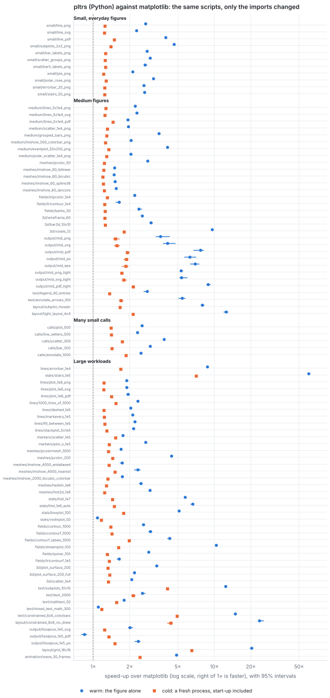
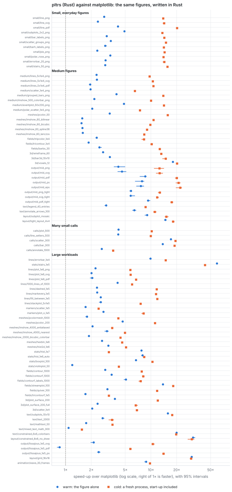
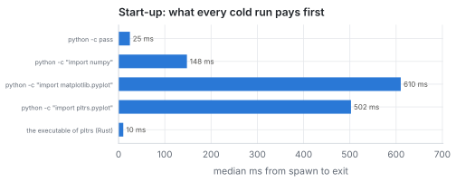

# Benchmarks of matplotlib, pltrs (Python) and pltrs (Rust)

<!-- Generated by `cargo xtask bench --report` (xtask/src/bench/report) from results.json; do not edit by hand. -->

This report times matplotlib 3.11.2 against both faces of pltrs on 91 workloads. pltrs (Python) runs the same Python scripts as matplotlib with only their imports changed. pltrs (Rust) draws the same figures from Rust. A speed-up such as "4.2× faster" means that matplotlib took 4.2 times as long.

The numbers were measured on 2026-11-06 at commit `f23741ce00-dirty`, on the machine described under [Machine and versions](#machine-and-versions). Every time of every run is in [`results.json`](results.json). pltrs (Rust) drew the charts from that file (`cargo xtask bench --rewrite-report` draws them again).

## Summary

The report makes two claims and measures them apart. pltrs (Python) against matplotlib compares one Python program with itself under two libraries. pltrs (Rust) against matplotlib compares a Rust program with a Python program that draws the same figure. Each claim has a warm number (the figure alone, in a running program) and a cold number (a whole program in a fresh process, start-up included). A workload counts as faster or slower only when the 95% confidence interval of its speed-up excludes 1. Otherwise it is within the noise. A tier's typical speed-up is the geometric mean over its workloads.

### pltrs (Python) as a drop-in replacement for matplotlib

Both columns run the same scripts on the same interpreter (Python 3.14.8, `~\AppData\Roaming\uv\python\cpython-3.14.8-windows-x86_64-none\python.exe`) and the same numpy build (2.5.4, core library digest `71521656365044a4`). Only the imports differ: `import matplotlib.pyplot as plt` reads `import pltrs.pyplot as plt`.

| tier | workloads | warm, faster / within noise / slower | warm, typical speed-up | cold, faster / within noise / slower | cold, typical speed-up |
|---|---:|---:|---:|---:|---:|
| Small, everyday figures | 11 | 11 / 0 / 0 | 2.9× faster | 11 / 0 / 0 | 1.29× faster |
| Medium figures | 29 | 29 / 0 / 0 | 3.2× faster | 29 / 0 / 0 | 1.44× faster |
| Many small calls | 5 | 5 / 0 / 0 | 2.8× faster | 5 / 0 / 0 | 1.56× faster |
| Large workloads | 42 | 41 / 0 / 1 | 3.3× faster | 42 / 0 / 0 | 1.67× faster |
| **all workloads** | 87 | 86 / 0 / 1 | 3.2× faster | 87 / 0 / 0 | 1.53× faster |



* pltrs (Python) is not faster warm on 1 of 87 workloads: `output/lissajous_1e5_pdf` (1.18× slower [1.12, 1.26]).
* pltrs (Python) is faster cold on all 87 workloads. The smallest speed-ups are `stats/violinplot_50` (1.17× faster [1.16, 1.18]), `text/mixed_text_math_300` (1.18× faster [1.15, 1.21]), `meshes/imshow_60_bicubic` (1.21× faster [1.20, 1.22]).

pltrs (Python) runs all 90 workloads matplotlib runs.
 The guard found that pltrs (Python) draws a different figure from matplotlib's in `output/mid_ps`, `output/mid_eps`, `output/lissajous_1e5_ps`, which the tallies leave out.
 The guard found that pltrs (Rust) draws a different figure from matplotlib's in `output/mid_ps`, `output/mid_eps`, `output/lissajous_1e5_ps`, which the tallies leave out.

### pltrs (Rust) against matplotlib

This claim compares programs in two languages that draw the same figure. A cold run of pltrs (Rust) starts a native executable, while a cold run of matplotlib starts the Python interpreter and imports numpy and pyplot, which alone take 610 ms here. The warm numbers leave start-up out on both sides.

| tier | workloads | warm, faster / within noise / slower | warm, typical speed-up | cold, faster / within noise / slower | cold, typical speed-up |
|---|---:|---:|---:|---:|---:|
| Small, everyday figures | 11 | 11 / 0 / 0 | 3.1× faster | 11 / 0 / 0 | 15× faster |
| Medium figures | 29 | 29 / 0 / 0 | 3.5× faster | 29 / 0 / 0 | 12× faster |
| Many small calls | 5 | 5 / 0 / 0 | 6.4× faster | 5 / 0 / 0 | 11× faster |
| Large workloads | 42 | 41 / 0 / 1 | 3.8× faster | 42 / 0 / 0 | 7.7× faster |
| **all workloads** | 87 | 86 / 0 / 1 | 3.7× faster | 87 / 0 / 0 | 9.8× faster |



* pltrs (Rust) is not faster warm on 1 of 87 workloads: `output/lissajous_1e5_pdf` (1.17× slower [1.14, 1.26]).
* pltrs (Rust) is faster cold on all 87 workloads. The smallest speed-ups are `text/mixed_text_math_300` (1.55× faster [1.52, 1.58]), `markers/scatter_1e5` (2.4× faster [2.4, 2.5]), `stats/hist_1e7` (3.2× faster [3.2, 3.2]).

### Start-up

A fresh interpreter takes 24.6 ms to start here and 148 ms to import numpy. One that imports `matplotlib.pyplot` takes 610 ms, and one that imports `pltrs.pyplot` takes 502 ms. The executable of pltrs (Rust) starts and exits in 10.3 ms. [Start-up and imports](#start-up-and-imports) has the details.



### Peak memory

* A cold run of pltrs (Python) typically peaks at 0.85 times the resident memory of matplotlib's run of the same workload, and at 0.39 to 1.01 times over all 90 workloads.
* A cold run of pltrs (Rust) typically peaks at 0.28 times the resident memory of matplotlib's run of the same workload, and at 0.14 to 0.58 times over all 90 workloads.

Both Python columns include the interpreter and numpy, which [Start-up and imports](#start-up-and-imports) measures alone. pltrs (Rust) has neither.

### Where the margins are thin

These speed-ups are under 1.50× faster, or are slowdowns. Three causes account for most of them. Cold, both Python columns spend most of a small figure's time starting the interpreter and importing numpy, which caps the cold speed-up of pltrs (Python). Where a large PNG or PDF stream is compressed, compression takes most of the time on both sides, and matplotlib's PNG goes through zlib-ng, which is faster than the zlib-like encoder of pltrs (see [Same work](#same-work)). Where every marker of a scatter has its own size, both libraries stroke and fill each one with the same Agg algorithms.

| workload | implementation | run | speed-up [95% interval] |
|---|---|---|---:|
| `meshes/imshow_60_bicubic` | pltrs (Python) | warm | 1.49× faster [1.49, 1.50] |
| `stats/violinplot_50` | pltrs (Python) | warm | 1.09× faster [1.06, 1.10] |
| `text/mixed_text_math_300` | pltrs (Python) | warm | 1.10× faster [1.09, 1.12] |
| `output/lissajous_1e5_pdf` | pltrs (Python) | warm | 1.18× slower [1.12, 1.26] |
| `small/line_png` | pltrs (Python) | cold | 1.25× faster [1.24, 1.27] |
| `small/line_svg` | pltrs (Python) | cold | 1.24× faster [1.22, 1.26] |
| `small/line_pdf` | pltrs (Python) | cold | 1.50× faster [1.46, 1.53] |
| `small/subplots_2x2_png` | pltrs (Python) | cold | 1.41× faster [1.38, 1.43] |
| `small/bar_labels_png` | pltrs (Python) | cold | 1.27× faster [1.24, 1.29] |
| `small/scatter_groups_png` | pltrs (Python) | cold | 1.26× faster [1.24, 1.28] |
| `medium/lines_5x1e4_png` | pltrs (Python) | cold | 1.28× faster [1.25, 1.30] |
| `medium/lines_5x1e4_svg` | pltrs (Python) | cold | 1.25× faster [1.24, 1.26] |
| `medium/lines_5x1e4_pdf` | pltrs (Python) | cold | 1.46× faster [1.43, 1.48] |
| `medium/scatter_1e4_png` | pltrs (Python) | cold | 1.31× faster [1.30, 1.34] |
| `medium/grouped_bars_png` | pltrs (Python) | cold | 1.30× faster [1.28, 1.33] |
| `medium/imshow_500_colorbar_png` | pltrs (Python) | cold | 1.27× faster [1.25, 1.28] |
| `small/barh_labels_png` | pltrs (Python) | cold | 1.27× faster [1.25, 1.29] |
| `small/pie_png` | pltrs (Python) | cold | 1.22× faster [1.20, 1.25] |
| `small/polar_rose_png` | pltrs (Python) | cold | 1.28× faster [1.27, 1.29] |
| `small/errorbar_20_png` | pltrs (Python) | cold | 1.25× faster [1.23, 1.27] |
| `small/stairs_50_png` | pltrs (Python) | cold | 1.25× faster [1.24, 1.26] |
| `medium/eventplot_50x200_png` | pltrs (Python) | cold | 1.35× faster [1.34, 1.37] |
| `medium/polar_scatter_1e4_png` | pltrs (Python) | cold | 1.29× faster [1.29, 1.31] |
| `calls/plot_500` | pltrs (Python) | cold | 1.41× faster [1.40, 1.42] |
| `calls/line_setters_500` | pltrs (Python) | cold | 1.42× faster [1.40, 1.43] |
| `calls/bar_300` | pltrs (Python) | cold | 1.43× faster [1.41, 1.46] |
| `lines/plot_1e6_png` | pltrs (Python) | cold | 1.23× faster [1.21, 1.24] |
| `lines/plot_1e6_svg` | pltrs (Python) | cold | 1.22× faster [1.21, 1.24] |
| `lines/plot_1e6_pdf` | pltrs (Python) | cold | 1.42× faster [1.41, 1.43] |
| `lines/dashed_1e5` | pltrs (Python) | cold | 1.23× faster [1.21, 1.24] |
| `lines/markevery_1e5` | pltrs (Python) | cold | 1.24× faster [1.21, 1.26] |
| `lines/fill_between_1e5` | pltrs (Python) | cold | 1.25× faster [1.22, 1.27] |
| `lines/stackplot_5x1e5` | pltrs (Python) | cold | 1.30× faster [1.28, 1.31] |
| `markers/plot_o_1e5` | pltrs (Python) | cold | 1.36× faster [1.34, 1.39] |
| `meshes/pcolormesh_1000` | pltrs (Python) | cold | 1.34× faster [1.32, 1.36] |
| `meshes/pcolor_50` | pltrs (Python) | cold | 1.24× faster [1.22, 1.25] |
| `meshes/pcolor_200` | pltrs (Python) | cold | 1.45× faster [1.43, 1.47] |
| `meshes/imshow_60_bilinear` | pltrs (Python) | cold | 1.23× faster [1.21, 1.24] |
| `meshes/imshow_60_bicubic` | pltrs (Python) | cold | 1.21× faster [1.20, 1.22] |
| `meshes/imshow_60_spline36` | pltrs (Python) | cold | 1.22× faster [1.20, 1.24] |
| `meshes/imshow_60_lanczos` | pltrs (Python) | cold | 1.24× faster [1.22, 1.25] |
| `meshes/imshow_4000_antialiased` | pltrs (Python) | cold | 1.36× faster [1.34, 1.37] |
| `meshes/imshow_2000_bicubic_colorbar` | pltrs (Python) | cold | 1.33× faster [1.31, 1.35] |
| `meshes/hexbin_1e6` | pltrs (Python) | cold | 1.29× faster [1.28, 1.30] |
| `meshes/hist2d_1e6` | pltrs (Python) | cold | 1.25× faster [1.23, 1.26] |
| `stats/hist_1e7` | pltrs (Python) | cold | 1.45× faster [1.43, 1.46] |
| `stats/hist_1e6_auto` | pltrs (Python) | cold | 1.50× faster [1.49, 1.50] |
| `stats/violinplot_50` | pltrs (Python) | cold | 1.17× faster [1.16, 1.18] |
| `fields/contour_1000` | pltrs (Python) | cold | 1.40× faster [1.39, 1.42] |
| `fields/contourf_1000` | pltrs (Python) | cold | 1.43× faster [1.42, 1.45] |
| `fields/quiver_100` | pltrs (Python) | cold | 1.31× faster [1.29, 1.35] |
| `fields/tricontourf_1e5` | pltrs (Python) | cold | 1.36× faster [1.34, 1.37] |
| `fields/tripcolor_1e4` | pltrs (Python) | cold | 1.31× faster [1.29, 1.34] |
| `fields/tricontour_1e4` | pltrs (Python) | cold | 1.25× faster [1.21, 1.27] |
| `fields/barbs_30` | pltrs (Python) | cold | 1.26× faster [1.23, 1.30] |
| `3d/plot_surface_200` | pltrs (Python) | cold | 1.33× faster [1.32, 1.35] |
| `3d/plot_surface_200_full` | pltrs (Python) | cold | 1.37× faster [1.35, 1.38] |
| `3d/scatter_1e4` | pltrs (Python) | cold | 1.34× faster [1.32, 1.37] |
| `3d/wireframe_60` | pltrs (Python) | cold | 1.25× faster [1.24, 1.28] |
| `3d/bar3d_10x10` | pltrs (Python) | cold | 1.26× faster [1.25, 1.28] |
| `text/mixed_text_math_300` | pltrs (Python) | cold | 1.18× faster [1.15, 1.21] |
| `output/lissajous_1e5_svg` | pltrs (Python) | cold | 1.25× faster [1.21, 1.28] |
| `output/lissajous_1e5_pdf` | pltrs (Python) | cold | 1.35× faster [1.32, 1.40] |
| `text/legend_40_entries` | pltrs (Python) | cold | 1.37× faster [1.34, 1.39] |
| `stats/violinplot_50` | pltrs (Rust) | warm | 1.20× faster [1.18, 1.22] |
| `text/mixed_text_math_300` | pltrs (Rust) | warm | 1.09× faster [1.08, 1.09] |
| `output/lissajous_1e5_pdf` | pltrs (Rust) | warm | 1.17× slower [1.14, 1.26] |

## How the comparison is kept fair

### Same output

Each workload is one figure. Its Python version is a script in [`benchmarks/python`](python) written for matplotlib. pltrs (Python) runs a copy in which every `import matplotlib...` reads `import pltrs...` and nothing else changes. Its Rust version is in [`xtask/src/bench/workloads`](../xtask/src/bench/workloads). Both make the same data from the same seeded generator (SplitMix64, drawn with numpy in Python).

All three draw in matplotlib's look with matplotlib's default rcParams: the same figure size, 100 dpi, DejaVu Sans, matplotlib's default hinting and antialiasing. pltrs (Python), which draws in its own modern look by default, runs with `PLTRS_LOOK=matplotlib`, and the Rust workloads select the same look in code. matplotlib and pltrs read their configuration from empty directories of the benchmark (`MPLCONFIGDIR`, `PLTRSCONFIGDIR`), so no rc file of the user's changes a default.

Before a workload is timed, the [correctness guard](#correctness-guard) has each implementation save its figure and compares it with matplotlib's.

* The pixels of the figure as PNG must be within an RMS difference of 2 (of 0 to 255) of matplotlib's. For an animation, every frame must be.
* An SVG, PDF, PostScript or EPS document must hold the same drawing operations as matplotlib's, with every number within 0.01. The comparison reduces both documents to their drawing operations and resolves every reference (glyphs, markers, clip paths, fonts, images), as the conformance spec's vector tests do (`pltrs_spec::figures::vector`). Ids, object numbers, metadata and compression are left out.

A figure that fails a check is timed but marked †, and the summary leaves it out.

### Same work

* **Metadata.** All three write their default metadata: creator, producer and date in PDF, PostScript and SVG, and the software's name in PNG. SVG ids come from the default random salt on every side.
* **PNG compression.** Both libraries compress at zlib's default level 6 and pick each row's filter adaptively (the smallest sum of absolute differences). matplotlib saves PNG through Pillow 12.3.0, whose zlib is zlib-ng 2.3.3. zlib-ng's level 6 is faster than zlib's and compresses a little less. pltrs' encoder works as zlib does, so its files are a few percent smaller and cost it more time. The tables give the size of every document.
* **PDF compression.** Streams are compressed at `pdf.compression` 6 on every side, by Python's zlib 1.3.1.zlib-ng in matplotlib and by pltrs' own DEFLATE, which works as zlib does (hash chains, lazy matching).
* **Paths.** Simplification and snapping keep their defaults on every side. The `output/lissajous_1e5_*` workloads turn `path.simplify` off on every side, so that each of the 10⁵ segments reaches the document.
* **Drawing without output.** `layout/constrained_8x8_no_draw` runs `fig.draw_without_rendering()` in Python and `Figure::draw_without_rendering` in Rust: every artist draws to a renderer that outputs nothing.
* **Caches.** A warm run must not profit from a cache one side keeps and the other lacks. matplotlib keeps one cache of laid-out text from one figure to the next, its last 50 parsed formulas (`MathTextParser._parse_cached`); its text metrics live with each figure's renderer. pltrs (Rust)'s text engine keeps every line, formula and glyph outline it has laid out. Before every warm run, the harness drops these caches on all three sides (outside the clock). Fonts stay loaded on every side, as matplotlib keeps its `FT2Font` objects and its font list.

### Same conditions

* **Data outside the clock.** Each script makes its data when it is imported, and each Rust workload before its first run. A warm run times `draw()` and `savefig` to memory in Python, and building the figure and saving it to memory in Rust. A cold run times the whole program, making its data included: numpy makes it in Python and plain Rust in pltrs (Rust), so that part differs by language too.
* **Teardown outside the clock.** After a warm run stops the clock, Python closes the figure (`plt.close`) and Rust drops it. Python's garbage collector stays on, as in a user's program, and runs a full collection before each warm run, outside the clock, so that no run pays for the garbage of the one before.
* **Warm runs in turns.** Each Python column serves its script from a long-lived process (`bench.py serve`) and pltrs (Rust) runs in the harness. After a warm-up run each, they take turns: one timed run each per round, in an order that rotates from round to round. A change in the machine's load or clock speed therefore weighs on all three alike. Each workload runs for at least 10 rounds, and more until the slowest implementation has run for 1 s, at most 50 rounds.
* **Cold runs in turns.** Each cold run is a fresh process: `python script.py out.png`, or the executable of pltrs (Rust) (`cargo xtask bench --child cold NAME out.png`). The three take turns the same way, for at least 10 rounds, and more until the slowest implementation has run for 2 s, at most 20 rounds. The harness times a run from `CreateProcess` (a venv's `python.exe`, a launcher on Windows that would run the interpreter as a second process, is replaced by the interpreter it starts, with the variable naming the venv that the launcher sets) to the child's exit. The scripts and the executable have run before, so the operating system's file cache and the libraries' font caches are warm.
* **One thread.** pltrs draws on one thread, as matplotlib does. Every Python process holds numpy's BLAS to one thread (`OPENBLAS_NUM_THREADS`, `OMP_NUM_THREADS` and `MKL_NUM_THREADS` set to 1). Left alone, OpenBLAS starts a thread per hardware thread when numpy is imported, which costs both Python columns the same ([Start-up and imports](#start-up-and-imports) measures it). No process is pinned to a CPU.
* **Peak memory.** Windows reports the peak working set of each cold process (`GetProcessMemoryInfo`), and the tables give the median over its runs.

### Statistics

The tables give the median time of each implementation and, in brackets, the interquartile range, which holds the middle half of the runs. A speed-up is matplotlib's median over the other's. Its 95% confidence interval comes from 2000 bootstrap resamples of the rounds, the runs of a round drawn together, with a fixed seed so that the same raw data gives the same intervals. A workload counts as faster or slower only when the interval excludes 1. Typical speed-ups are geometric means, the average that treats 2× faster and 2× slower symmetrically.

### Claims kept apart

* pltrs (Python) against matplotlib is the drop-in claim: the same script, the same interpreter, the same numpy, only the imports changed.
* pltrs (Rust) against matplotlib compares the same figure written natively in each language. It says how fast the figure can be made, not how fast a Python program becomes.
* Cold runs include start-up, which differs by language. The summary gives warm and cold numbers apart and never averages them together or across claims.

## What is not compared

* PGF output. matplotlib's PGF backend runs LaTeX to measure every text, while pltrs lays PGF out with its own font metrics. The PGF time of pltrs (Rust) stands alone in the tables.
* Text set by TeX (`text.usetex`). Both libraries run the same external TeX programs, whose time would dominate.
* Interactive windows. Their frame rate depends on the display server and the screen, not on the library alone.
* GIF and video files of animations. matplotlib hands frames to Pillow's GIF encoder or to ffmpeg, which quantize and encode differently from pltrs. The animation workload renders its frames as PNG into the page of the JavaScript player instead (`to_jshtml`), the same work on every side.
* The memory of warm runs. The warm runs of pltrs (Rust) share the harness's process, so only cold processes give a clean peak.

## Machine and versions

| | |
|---|---|
| CPU | Intel(R) Core(TM) i9-10900K CPU @ 3.70GHz |
| cores | 10 cores, 20 threads |
| memory | 64 GiB |
| operating system | Microsoft Windows 11 Pro, Windows NT 10.0.26200 |
| CPU frequency governor | power plan 1048575 |
| CPUs the processes may run on | unknown |
| processor load | 10% busy at the start, 58% busy at the end |
| Rust | rustc 1.99.1 (58cf8f9c3 2026-10-13) |

| | matplotlib's venv | pltrs (Python)'s venv |
|---|---|---|
| Python | 3.14.8 | 3.14.8 |
| interpreter | ~\AppData\Roaming\uv\python\cpython-3.14.8-windows-x86_64-none\python.exe | ~\AppData\Roaming\uv\python\cpython-3.14.8-windows-x86_64-none\python.exe |
| numpy | 2.5.4 | 2.5.4 |
| numpy core library (SHA-256 prefix) | 71521656365044a4 | 71521656365044a4 |
| Pillow | 12.3.0 | 12.3.0 |
| Pillow's zlib-ng | 2.3.3 | 2.3.3 |
| Python's zlib | 1.3.1.zlib-ng | 1.3.1.zlib-ng |
| matplotlib | 3.11.2 | unknown |

Other work may share the machine while the benchmark runs, as the load average shows. The rounds spread that noise over all three implementations, and the intervals show what is left of it.

## Start-up and imports

These fresh processes only start, import and exit. Every cold run costs at least as much.

| process | median ms [IQR] | peak memory MiB |
|---|---:|---:|
| `python -c pass` | 24.6 [24.3, 25.4] | 11 |
| `python -c "import numpy"` | 148 [146, 152] | 25 |
| `python -c "import numpy"`, OpenBLAS's default of 20 threads | 148 [147, 153] | 27 |
| `python -c "import matplotlib.pyplot"` | 610 [605, 626] | 63 |
| `python -c "import pltrs.pyplot"` | 502 [496, 507] | 57 |
| the executable of pltrs (Rust), starting and exiting | 10.3 [10.0, 10.5] | 8 |

Both pyplot modules import numpy. Beyond numpy, importing `matplotlib.pyplot` costs 462 ms and importing `pltrs.pyplot` 355 ms.

## Small, everyday figures

### Warm, in-process

The figure alone: built and saved to memory in a running program. Times are medians in ms with the interquartile range in brackets. Speed-ups are against matplotlib, with their 95% interval.

| workload | matplotlib | pltrs (Python) | speed-up | pltrs (Rust) | speed-up |
|---|---:|---:|---:|---:|---:|
| `small/line_png` | 56.4 [55.6, 57.5] | 20.8 [20.5, 21.2] | 2.7× faster [2.7, 2.8] | 19.9 [19.7, 20.0] | 2.8× faster [2.8, 2.9] |
| `small/line_svg` | 45.1 [43.9, 45.5] | 19.7 [19.6, 19.8] | 2.3× faster [2.2, 2.3] | 18.8 [18.7, 19.0] | 2.4× faster [2.3, 2.4] |
| `small/line_pdf` | 50.1 [49.2, 50.8] | 12.6 [12.6, 12.7] | 4.0× faster [3.9, 4.0] | 12.2 [12.1, 12.3] | 4.1× faster [4.0, 4.2] |
| `small/subplots_2x2_png` | 144 [143, 146] | 30.8 [30.6, 30.9] | 4.7× faster [4.6, 4.8] | 29.3 [29.1, 29.6] | 4.9× faster [4.8, 5.0] |
| `small/bar_labels_png` | 57.0 [56.5, 57.8] | 20.4 [20.3, 20.6] | 2.8× faster [2.8, 2.8] | 18.8 [18.5, 18.9] | 3.0× faster [3.0, 3.1] |
| `small/scatter_groups_png` | 54.3 [53.5, 55.5] | 18.3 [18.1, 18.5] | 3.0× faster [2.9, 3.0] | 16.0 [16.0, 16.1] | 3.4× faster [3.3, 3.5] |
| `small/barh_labels_png` | 60.7 [59.9, 63.1] | 22.6 [22.4, 22.6] | 2.7× faster [2.7, 2.8] | 20.8 [20.7, 21.0] | 2.9× faster [2.9, 3.0] |
| `small/pie_png` | 39.8 [39.3, 40.1] | 18.7 [18.5, 18.9] | 2.1× faster [2.1, 2.2] | 16.9 [16.8, 17.0] | 2.4× faster [2.3, 2.4] |
| `small/polar_rose_png` | 70.6 [69.6, 71.7] | 22.4 [22.3, 22.7] | 3.2× faster [3.1, 3.2] | 21.1 [20.9, 21.3] | 3.3× faster [3.3, 3.4] |
| `small/errorbar_20_png` | 49.5 [49.0, 50.5] | 18.9 [18.5, 19.1] | 2.6× faster [2.6, 2.7] | 16.8 [16.8, 17.0] | 2.9× faster [2.9, 3.0] |
| `small/stairs_50_png` | 41.2 [40.1, 41.7] | 15.5 [15.3, 15.6] | 2.7× faster [2.6, 2.7] | 14.1 [14.0, 14.5] | 2.9× faster [2.9, 2.9] |

### Cold, end to end

A fresh process that starts, imports, makes the data, builds the figure, writes the file and exits. Times are medians in ms with the interquartile range in brackets. Speed-ups are against matplotlib, with their 95% interval.

| workload | matplotlib | pltrs (Python) | speed-up | pltrs (Rust) | speed-up |
|---|---:|---:|---:|---:|---:|
| `small/line_png` | 693 [687, 696] | 553 [547, 555] | 1.25× faster [1.24, 1.27] | 49.8 [48.9, 50.7] | 14× faster [14, 14] |
| `small/line_svg` | 680 [674, 682] | 547 [543, 553] | 1.24× faster [1.22, 1.26] | 47.6 [47.1, 49.1] | 14× faster [14, 14] |
| `small/line_pdf` | 828 [822, 831] | 553 [545, 560] | 1.50× faster [1.46, 1.53] | 40.9 [40.6, 41.3] | 20× faster [20, 21] |
| `small/subplots_2x2_png` | 786 [776, 792] | 559 [553, 566] | 1.41× faster [1.38, 1.43] | 57.7 [57.0, 58.2] | 14× faster [13, 14] |
| `small/bar_labels_png` | 693 [684, 695] | 546 [542, 551] | 1.27× faster [1.24, 1.29] | 48.3 [47.7, 48.8] | 14× faster [14, 15] |
| `small/scatter_groups_png` | 686 [679, 692] | 545 [541, 549] | 1.26× faster [1.24, 1.28] | 45.7 [45.2, 45.9] | 15× faster [15, 15] |
| `small/barh_labels_png` | 699 [694, 705] | 551 [547, 554] | 1.27× faster [1.25, 1.29] | 49.3 [49.0, 49.8] | 14× faster [14, 14] |
| `small/pie_png` | 673 [665, 677] | 550 [542, 555] | 1.22× faster [1.20, 1.25] | 46.5 [46.2, 46.7] | 14× faster [14, 15] |
| `small/polar_rose_png` | 709 [703, 713] | 553 [551, 554] | 1.28× faster [1.27, 1.29] | 50.5 [49.9, 51.1] | 14× faster [14, 14] |
| `small/errorbar_20_png` | 686 [680, 687] | 550 [541, 553] | 1.25× faster [1.23, 1.27] | 47.7 [47.3, 49.7] | 14× faster [14, 15] |
| `small/stairs_50_png` | 676 [672, 682] | 542 [538, 545] | 1.25× faster [1.24, 1.26] | 43.3 [42.8, 43.9] | 16× faster [15, 16] |

### Peak memory and document size

Peak memory is the median peak resident memory of the cold processes, in MiB. The size is that of the document the warm runs saved, in KiB.

| workload | format | matplotlib MiB | pltrs (Python) MiB | pltrs (Rust) MiB | matplotlib KiB | pltrs (Python) KiB | pltrs (Rust) KiB |
|---|---|---:|---:|---:|---:|---:|---:|
| `small/line_png` | png | 68 | 62 | 14 | 29 | 29 | 29 |
| `small/line_svg` | svg | 66 | 60 | 12 | 25 | 25 | 25 |
| `small/line_pdf` | pdf | 77 | 61 | 13 | 13 | 13 | 13 |
| `small/subplots_2x2_png` | png | 70 | 63 | 15 | 37 | 38 | 38 |
| `small/bar_labels_png` | png | 68 | 62 | 15 | 16 | 16 | 16 |
| `small/scatter_groups_png` | png | 68 | 63 | 15 | 21 | 21 | 21 |
| `small/barh_labels_png` | png | 68 | 62 | 16 | 17 | 17 | 17 |
| `small/pie_png` | png | 67 | 62 | 16 | 28 | 28 | 28 |
| `small/polar_rose_png` | png | 68 | 63 | 17 | 65 | 65 | 65 |
| `small/errorbar_20_png` | png | 68 | 62 | 16 | 15 | 15 | 15 |
| `small/stairs_50_png` | png | 68 | 62 | 16 | 10 | 10 | 10 |

## Medium figures

### Warm, in-process

The figure alone: built and saved to memory in a running program. Times are medians in ms with the interquartile range in brackets. Speed-ups are against matplotlib, with their 95% interval.

| workload | matplotlib | pltrs (Python) | speed-up | pltrs (Rust) | speed-up |
|---|---:|---:|---:|---:|---:|
| `medium/lines_5x1e4_png` | 101 [99.6, 103] | 45.2 [44.4, 45.5] | 2.2× faster [2.2, 2.3] | 43.7 [43.6, 44.2] | 2.3× faster [2.3, 2.4] |
| `medium/lines_5x1e4_svg` | 78.1 [76.2, 79.4] | 33.9 [33.8, 34.3] | 2.3× faster [2.2, 2.3] | 33.5 [33.2, 33.8] | 2.3× faster [2.3, 2.4] |
| `medium/lines_5x1e4_pdf` | 91.8 [89.1, 92.5] | 47.3 [47.2, 48.0] | 1.94× faster [1.88, 1.96] | 47.2 [46.9, 47.6] | 1.94× faster [1.88, 1.96] |
| `medium/scatter_1e4_png` | 188 [187, 188] | 95.8 [95.5, 96.4] | 1.96× faster [1.94, 1.97] | 95.5 [95.0, 96.7] | 1.96× faster [1.93, 1.98] |
| `medium/grouped_bars_png` | 82.0 [80.5, 84.3] | 23.4 [23.1, 23.5] | 3.5× faster [3.5, 3.6] | 20.8 [20.4, 20.9] | 3.9× faster [3.9, 4.1] |
| `medium/imshow_500_colorbar_png` | 90.2 [87.7, 90.8] | 43.7 [43.2, 44.0] | 2.1× faster [2.0, 2.1] | 41.4 [41.3, 41.8] | 2.2× faster [2.1, 2.2] |
| `medium/eventplot_50x200_png` | 107 [106, 108] | 26.1 [25.9, 26.4] | 4.1× faster [4.1, 4.2] | 22.2 [22.0, 22.4] | 4.8× faster [4.7, 4.9] |
| `medium/polar_scatter_1e4_png` | 159 [157, 160] | 77.5 [77.3, 79.0] | 2.1× faster [2.0, 2.1] | 77.5 [77.1, 77.6] | 2.1× faster [2.0, 2.1] |
| `meshes/pcolor_50` | 40.0 [39.7, 41.1] | 14.2 [14.1, 14.3] | 2.8× faster [2.8, 2.9] | 12.2 [12.1, 12.2] | 3.3× faster [3.3, 3.4] |
| `meshes/imshow_60_bilinear` | 52.9 [52.2, 53.9] | 35.1 [34.8, 35.5] | 1.51× faster [1.49, 1.53] | 33.7 [33.7, 33.9] | 1.57× faster [1.55, 1.60] |
| `meshes/imshow_60_bicubic` | 59.1 [59.0, 59.5] | 39.7 [39.5, 39.7] | 1.49× faster [1.49, 1.50] | 38.5 [38.3, 38.6] | 1.54× faster [1.53, 1.55] |
| `meshes/imshow_60_spline36` | 72.1 [70.8, 72.7] | 47.4 [47.2, 47.7] | 1.52× faster [1.49, 1.54] | 45.7 [45.5, 46.1] | 1.58× faster [1.54, 1.59] |
| `meshes/imshow_60_lanczos` | 87.6 [87.1, 88.2] | 56.4 [56.4, 56.7] | 1.55× faster [1.54, 1.56] | 55.0 [54.9, 55.2] | 1.59× faster [1.58, 1.60] |
| `fields/tripcolor_1e4` | 144 [143, 145] | 65.3 [64.8, 66.7] | 2.2× faster [2.1, 2.2] | 62.1 [61.6, 63.5] | 2.3× faster [2.2, 2.4] |
| `fields/tricontour_1e4` | 73.6 [72.5, 74.7] | 44.8 [44.1, 48.0] | 1.64× faster [1.54, 1.68] | 39.5 [39.0, 40.5] | 1.86× faster [1.81, 1.89] |
| `fields/barbs_30` | 69.0 [67.6, 72.9] | 28.9 [28.7, 29.1] | 2.4× faster [2.3, 2.5] | 27.7 [27.4, 27.9] | 2.5× faster [2.4, 2.7] |
| `3d/wireframe_60` | 63.9 [62.9, 65.6] | 25.1 [24.8, 25.3] | 2.5× faster [2.5, 2.6] | 23.2 [23.1, 23.5] | 2.8× faster [2.7, 2.8] |
| `3d/bar3d_10x10` | 57.9 [57.0, 59.1] | 19.2 [19.1, 19.9] | 3.0× faster [2.9, 3.1] | 17.5 [17.4, 17.7] | 3.3× faster [3.2, 3.4] |
| `3d/voxels_12` | 391 [391, 397] | 40.7 [40.6, 40.8] | 9.6× faster [9.6, 9.8] | 21.6 [21.6, 21.8] | 18× faster [18, 18] |
| `output/mid_png` | 292 [272, 330] | 81.1 [77.2, 83.5] | 3.6× faster [3.3, 4.3] | 70.3 [64.7, 72.8] | 4.2× faster [3.7, 5.0] |
| `output/mid_svg` | 355 [333, 389] | 86.3 [79.7, 88.6] | 4.1× faster [3.8, 4.8] | 77.5 [74.0, 83.8] | 4.6× faster [4.1, 5.1] |
| `output/mid_pdf` | 455 [427, 461] | 59.1 [56.5, 63.0] | 7.7× faster [6.7, 8.2] | 53.0 [51.9, 59.5] | 8.6× faster [7.4, 8.9] |
| `output/mid_ps` | 325 [309, 341] | 51.6 [46.6, 55.2] | 6.3× faster [5.7, 7.1] † | 41.3 [40.7, 47.2] | 7.9× faster [6.5, 8.3] † |
| `output/mid_pgf` | not comparable | not comparable | n/a | 67.5 [65.5, 74.0] | n/a |
| `output/mid_eps` | 315 [295, 324] | 45.2 [42.9, 49.5] | 7.0× faster [6.3, 7.5] † | 41.3 [38.7, 44.3] | 7.6× faster [6.7, 8.3] † |
| `output/mid_png_tight` | 371 [364, 381] | 69.8 [69.3, 70.0] | 5.3× faster [5.2, 5.5] | 63.6 [63.4, 65.7] | 5.8× faster [5.6, 6.0] |
| `output/mid_svg_tight` | 430 [424, 466] | 79.9 [76.7, 82.2] | 5.4× faster [5.1, 6.0] | 74.1 [71.9, 75.1] | 5.8× faster [5.6, 6.5] |
| `output/mid_pdf_tight` | 495 [486, 508] | 55.6 [53.9, 56.7] | 8.9× faster [8.6, 9.3] | 53.4 [51.8, 53.6] | 9.3× faster [9.0, 9.8] |
| `text/legend_40_entries` | 231 [227, 236] | 82.3 [81.4, 88.1] | 2.8× faster [2.6, 2.9] | 77.0 [76.5, 79.7] | 3.0× faster [2.9, 3.0] |
| `text/annotate_arrows_100` | 443 [433, 450] | 81.4 [77.9, 86.9] | 5.4× faster [5.1, 5.8] | 69.2 [68.8, 71.6] | 6.4× faster [6.0, 6.7] |
| `layout/subplot_mosaic` | 313 [308, 315] | 39.3 [38.0, 39.8] | 8.0× faster [7.8, 8.3] | 34.6 [33.9, 35.5] | 9.0× faster [8.5, 9.3] |
| `layout/tight_layout_4x4` | 679 [673, 686] | 54.1 [52.2, 56.4] | 13× faster [12, 13] | 45.9 [45.7, 47.3] | 15× faster [14, 15] |

### Cold, end to end

A fresh process that starts, imports, makes the data, builds the figure, writes the file and exits. Times are medians in ms with the interquartile range in brackets. Speed-ups are against matplotlib, with their 95% interval.

| workload | matplotlib | pltrs (Python) | speed-up | pltrs (Rust) | speed-up |
|---|---:|---:|---:|---:|---:|
| `medium/lines_5x1e4_png` | 738 [737, 743] | 578 [570, 588] | 1.28× faster [1.25, 1.30] | 76.5 [75.9, 77.3] | 9.6× faster [9.5, 9.8] |
| `medium/lines_5x1e4_svg` | 709 [708, 714] | 566 [564, 570] | 1.25× faster [1.24, 1.26] | 67.4 [66.7, 67.7] | 11× faster [10, 11] |
| `medium/lines_5x1e4_pdf` | 876 [870, 882] | 599 [595, 611] | 1.46× faster [1.43, 1.48] | 81.9 [81.3, 82.7] | 11× faster [11, 11] |
| `medium/scatter_1e4_png` | 823 [820, 832] | 626 [617, 632] | 1.31× faster [1.30, 1.34] | 127 [126, 127] | 6.5× faster [6.4, 6.6] |
| `medium/grouped_bars_png` | 717 [713, 731] | 553 [548, 559] | 1.30× faster [1.28, 1.33] | 51.3 [50.9, 52.0] | 14× faster [14, 14] |
| `medium/imshow_500_colorbar_png` | 729 [720, 730] | 575 [571, 579] | 1.27× faster [1.25, 1.28] | 72.6 [72.0, 74.0] | 10× faster [9.8, 10] |
| `medium/eventplot_50x200_png` | 749 [745, 753] | 556 [554, 557] | 1.35× faster [1.34, 1.37] | 52.7 [51.8, 53.5] | 14× faster [14, 15] |
| `medium/polar_scatter_1e4_png` | 790 [788, 797] | 610 [607, 612] | 1.29× faster [1.29, 1.31] | 106 [105, 109] | 7.4× faster [7.2, 7.6] |
| `meshes/pcolor_50` | 658 [654, 660] | 530 [526, 538] | 1.24× faster [1.22, 1.25] | 41.8 [41.2, 42.4] | 16× faster [15, 16] |
| `meshes/imshow_60_bilinear` | 676 [671, 677] | 552 [546, 558] | 1.23× faster [1.21, 1.24] | 63.0 [62.3, 63.7] | 11× faster [11, 11] |
| `meshes/imshow_60_bicubic` | 674 [669, 678] | 559 [556, 560] | 1.21× faster [1.20, 1.22] | 68.4 [68.2, 69.5] | 9.8× faster [9.7, 9.9] |
| `meshes/imshow_60_spline36` | 685 [682, 691] | 562 [556, 568] | 1.22× faster [1.20, 1.24] | 76.0 [75.2, 77.2] | 9.0× faster [8.9, 9.1] |
| `meshes/imshow_60_lanczos` | 708 [702, 712] | 571 [568, 575] | 1.24× faster [1.22, 1.25] | 84.7 [84.2, 85.9] | 8.4× faster [8.2, 8.4] |
| `fields/tripcolor_1e4` | 807 [804, 816] | 615 [606, 621] | 1.31× faster [1.29, 1.34] | 97.1 [95.8, 101] | 8.3× faster [7.8, 8.5] |
| `fields/tricontour_1e4` | 740 [732, 744] | 593 [586, 604] | 1.25× faster [1.21, 1.27] | 72.4 [71.7, 73.9] | 10× faster [9.8, 10] |
| `fields/barbs_30` | 725 [717, 740] | 576 [568, 580] | 1.26× faster [1.23, 1.30] | 57.1 [57.0, 57.8] | 13× faster [12, 13] |
| `3d/wireframe_60` | 711 [703, 722] | 568 [563, 574] | 1.25× faster [1.24, 1.28] | 53.8 [53.0, 54.4] | 13× faster [13, 14] |
| `3d/bar3d_10x10` | 712 [708, 716] | 565 [557, 567] | 1.26× faster [1.25, 1.28] | 47.7 [47.2, 49.9] | 15× faster [14, 15] |
| `3d/voxels_12` | 1076 [1069, 1093] | 596 [588, 601] | 1.80× faster [1.79, 1.83] | 53.2 [52.3, 54.2] | 20× faster [20, 21] |
| `output/mid_png` | 1546 [1506, 1653] | 1009 [984, 1054] | 1.53× faster [1.46, 1.65] | 123 [117, 137] | 13× faster [11, 14] |
| `output/mid_svg` | 1613 [1539, 1627] | 1025 [977, 1047] | 1.57× faster [1.49, 1.67] | 127 [119, 134] | 13× faster [11, 14] |
| `output/mid_pdf` | 1921 [1899, 1947] | 1002 [974, 1024] | 1.92× faster [1.87, 2.0] | 95.4 [94.0, 99.9] | 20× faster [19, 21] |
| `output/mid_ps` | 1734 [1658, 1791] | 919 [902, 941] | 1.89× faster [1.78, 1.96] † | 82.3 [79.9, 87.1] | 21× faster [19, 22] † |
| `output/mid_pgf` | not comparable | not comparable | n/a | 123 [116, 135] | n/a |
| `output/mid_eps` | 1698 [1577, 1765] | 909 [883, 926] | 1.87× faster [1.73, 1.95] † | 76.9 [75.5, 84.9] | 22× faster [20, 23] † |
| `output/mid_png_tight` | 1322 [1317, 1339] | 764 [749, 785] | 1.73× faster [1.67, 1.77] | 104 [102, 109] | 13× faster [12, 13] |
| `output/mid_svg_tight` | 1391 [1371, 1442] | 775 [747, 802] | 1.79× faster [1.73, 1.90] | 117 [116, 119] | 12× faster [12, 12] |
| `output/mid_pdf_tight` | 1587 [1555, 1619] | 738 [733, 757] | 2.1× faster [2.1, 2.2] | 90.5 [88.6, 93.2] | 18× faster [17, 18] |
| `text/legend_40_entries` | 983 [968, 987] | 717 [708, 724] | 1.37× faster [1.34, 1.39] | 113 [112, 116] | 8.7× faster [8.4, 8.9] |
| `text/annotate_arrows_100` | 1193 [1173, 1225] | 702 [692, 719] | 1.70× faster [1.63, 1.78] | 107 [103, 111] | 11× faster [11, 12] |
| `layout/subplot_mosaic` | 1091 [1086, 1107] | 653 [646, 664] | 1.67× faster [1.63, 1.71] | 71.9 [68.8, 73.3] | 15× faster [15, 16] |
| `layout/tight_layout_4x4` | 1486 [1479, 1496] | 694 [682, 703] | 2.1× faster [2.1, 2.2] | 81.7 [79.2, 83.6] | 18× faster [18, 19] |

### Peak memory and document size

Peak memory is the median peak resident memory of the cold processes, in MiB. The size is that of the document the warm runs saved, in KiB.

| workload | format | matplotlib MiB | pltrs (Python) MiB | pltrs (Rust) MiB | matplotlib KiB | pltrs (Python) KiB | pltrs (Rust) KiB |
|---|---|---:|---:|---:|---:|---:|---:|
| `medium/lines_5x1e4_png` | png | 72 | 67 | 19 | 66 | 67 | 67 |
| `medium/lines_5x1e4_svg` | svg | 69 | 65 | 17 | 554 | 554 | 554 |
| `medium/lines_5x1e4_pdf` | pdf | 80 | 66 | 17 | 221 | 218 | 218 |
| `medium/scatter_1e4_png` | png | 70 | 63 | 17 | 112 | 112 | 112 |
| `medium/grouped_bars_png` | png | 68 | 63 | 16 | 15 | 15 | 15 |
| `medium/imshow_500_colorbar_png` | png | 89 | 73 | 25 | 121 | 122 | 122 |
| `medium/eventplot_50x200_png` | png | 72 | 64 | 17 | 19 | 19 | 19 |
| `medium/polar_scatter_1e4_png` | png | 69 | 64 | 17 | 232 | 235 | 235 |
| `meshes/pcolor_50` | png | 69 | 63 | 17 | 18 | 18 | 18 |
| `meshes/imshow_60_bilinear` | png | 70 | 65 | 20 | 107 | 108 | 108 |
| `meshes/imshow_60_bicubic` | png | 70 | 65 | 20 | 106 | 107 | 107 |
| `meshes/imshow_60_spline36` | png | 70 | 65 | 20 | 110 | 111 | 111 |
| `meshes/imshow_60_lanczos` | png | 70 | 65 | 20 | 110 | 111 | 111 |
| `fields/tripcolor_1e4` | png | 76 | 66 | 21 | 104 | 106 | 106 |
| `fields/tricontour_1e4` | png | 70 | 65 | 20 | 71 | 72 | 72 |
| `fields/barbs_30` | png | 68 | 62 | 17 | 98 | 100 | 100 |
| `3d/wireframe_60` | png | 68 | 62 | 18 | 115 | 116 | 116 |
| `3d/bar3d_10x10` | png | 69 | 62 | 18 | 53 | 53 | 53 |
| `3d/voxels_12` | png | 74 | 65 | 19 | 66 | 67 | 67 |
| `output/mid_png` | png | 75 | 65 | 19 | 82 | 82 | 82 |
| `output/mid_svg` | svg | 73 | 63 | 18 | 373 | 373 | 373 |
| `output/mid_pdf` | pdf | 84 | 64 | 18 | 81 | 81 | 81 |
| `output/mid_ps` | ps | 85 | 63 | 18 | 314 | 314 | 314 |
| `output/mid_pgf` | pgf | not comparable | not comparable | 27 | not comparable | not comparable | 3176 |
| `output/mid_eps` | eps | 85 | 63 | 18 | 314 | 314 | 314 |
| `output/mid_png_tight` | png | 76 | 64 | 20 | 80 | 81 | 81 |
| `output/mid_svg_tight` | svg | 74 | 63 | 18 | 374 | 374 | 374 |
| `output/mid_pdf_tight` | pdf | 85 | 64 | 18 | 81 | 81 | 81 |
| `text/legend_40_entries` | png | 71 | 65 | 21 | 433 | 446 | 446 |
| `text/annotate_arrows_100` | png | 69 | 63 | 19 | 44 | 45 | 45 |
| `layout/subplot_mosaic` | png | 71 | 64 | 19 | 41 | 41 | 41 |
| `layout/tight_layout_4x4` | png | 76 | 65 | 21 | 120 | 122 | 122 |

### What a call costs in pltrs (Python)

pltrs (Python) and pltrs (Rust) run the same Rust code for these figures. On every call pltrs (Python) also handles matplotlib's signature and keywords, converts the arguments, crosses into the extension and makes the Python object of the artist it returns. The table divides the difference of their warm medians by the number of calls, and gives matplotlib's whole time per call beside it.

| workload | calls | pltrs (Python) over pltrs (Rust), µs per call | matplotlib, µs per call |
|---|---:|---:|---:|
| `text/annotate_arrows_100` | 101 | 120.7 | 4382.4 |

† The figure differs from matplotlib's, as the [correctness guard](#correctness-guard) shows.

`output/mid_pgf` is not comparable: matplotlib's PGF backend runs LaTeX to measure every text, while pltrs lays PGF out with its own font metrics.

## Many small calls

### Warm, in-process

The figure alone: built and saved to memory in a running program. Times are medians in ms with the interquartile range in brackets. Speed-ups are against matplotlib, with their 95% interval.

| workload | matplotlib | pltrs (Python) | speed-up | pltrs (Rust) | speed-up |
|---|---:|---:|---:|---:|---:|
| `calls/plot_500` | 224 [221, 225] | 88.2 [87.7, 88.8] | 2.5× faster [2.5, 2.6] | 53.6 [52.9, 54.1] | 4.2× faster [4.1, 4.3] |
| `calls/line_setters_500` | 242 [241, 244] | 104 [104, 105] | 2.3× faster [2.3, 2.4] | 58.5 [57.9, 59.2] | 4.1× faster [4.1, 4.2] |
| `calls/scatter_300` | 532 [529, 535] | 138 [136, 140] | 3.9× faster [3.8, 3.9] | 31.0 [30.8, 31.3] | 17× faster [17, 17] |
| `calls/bar_300` | 228 [227, 231] | 76.9 [76.5, 77.4] | 3.0× faster [2.9, 3.0] | 16.6 [16.3, 16.7] | 14× faster [14, 14] |
| `calls/annotate_1000` | 1411 [1409, 1422] | 568 [562, 571] | 2.5× faster [2.5, 2.5] | 531 [530, 531] | 2.7× faster [2.7, 2.7] |

### Cold, end to end

A fresh process that starts, imports, makes the data, builds the figure, writes the file and exits. Times are medians in ms with the interquartile range in brackets. Speed-ups are against matplotlib, with their 95% interval.

| workload | matplotlib | pltrs (Python) | speed-up | pltrs (Rust) | speed-up |
|---|---:|---:|---:|---:|---:|
| `calls/plot_500` | 860 [857, 866] | 610 [607, 615] | 1.41× faster [1.40, 1.42] | 84.2 [83.4, 84.4] | 10× faster [10, 10] |
| `calls/line_setters_500` | 885 [876, 889] | 625 [623, 628] | 1.42× faster [1.40, 1.43] | 88.8 [88.7, 89.0] | 10× faster [9.9, 10] |
| `calls/scatter_300` | 1173 [1168, 1183] | 672 [666, 681] | 1.74× faster [1.73, 1.77] | 60.5 [60.3, 61.3] | 19× faster [19, 20] |
| `calls/bar_300` | 857 [855, 864] | 598 [593, 607] | 1.43× faster [1.41, 1.46] | 45.3 [44.6, 45.8] | 19× faster [19, 19] |
| `calls/annotate_1000` | 2045 [2034, 2048] | 1093 [1081, 1098] | 1.87× faster [1.86, 1.89] | 566 [564, 569] | 3.6× faster [3.6, 3.6] |

### Peak memory and document size

Peak memory is the median peak resident memory of the cold processes, in MiB. The size is that of the document the warm runs saved, in KiB.

| workload | format | matplotlib MiB | pltrs (Python) MiB | pltrs (Rust) MiB | matplotlib KiB | pltrs (Python) KiB | pltrs (Rust) KiB |
|---|---|---:|---:|---:|---:|---:|---:|
| `calls/plot_500` | png | 75 | 65 | 19 | 338 | 340 | 340 |
| `calls/line_setters_500` | png | 75 | 65 | 19 | 384 | 386 | 386 |
| `calls/scatter_300` | png | 74 | 66 | 18 | 129 | 132 | 132 |
| `calls/bar_300` | png | 72 | 63 | 17 | 9 | 9 | 9 |
| `calls/annotate_1000` | png | 72 | 68 | 20 | 207 | 208 | 208 |

### What a call costs in pltrs (Python)

pltrs (Python) and pltrs (Rust) run the same Rust code for these figures. On every call pltrs (Python) also handles matplotlib's signature and keywords, converts the arguments, crosses into the extension and makes the Python object of the artist it returns. The table divides the difference of their warm medians by the number of calls, and gives matplotlib's whole time per call beside it.

| workload | calls | pltrs (Python) over pltrs (Rust), µs per call | matplotlib, µs per call |
|---|---:|---:|---:|
| `calls/plot_500` | 500 | 69.2 | 447.4 |
| `calls/line_setters_500` | 2000 | 22.8 | 121.1 |
| `calls/scatter_300` | 300 | 355.8 | 1771.9 |
| `calls/bar_300` | 300 | 201.1 | 759.3 |
| `calls/annotate_1000` | 1001 | 36.8 | 1409.1 |

## Large workloads

### Warm, in-process

The figure alone: built and saved to memory in a running program. Times are medians in ms with the interquartile range in brackets. Speed-ups are against matplotlib, with their 95% interval.

| workload | matplotlib | pltrs (Python) | speed-up | pltrs (Rust) | speed-up |
|---|---:|---:|---:|---:|---:|
| `lines/errorbar_1e4` | 317 [315, 319] | 36.1 [35.7, 36.6] | 8.8× faster [8.6, 9.0] | 32.0 [31.4, 32.8] | 9.9× faster [9.6, 10] |
| `stats/stairs_1e5` | 3570 [3559, 3589] | 59.3 [59.1, 59.8] | 60× faster [59, 61] | 60.1 [59.7, 60.6] | 59× faster [59, 60] |
| `lines/plot_1e6_png` | 122 [121, 123] | 64.3 [63.7, 64.9] | 1.90× faster [1.86, 1.93] | 54.3 [53.9, 54.8] | 2.2× faster [2.2, 2.3] |
| `lines/plot_1e6_svg` | 107 [107, 108] | 56.5 [56.1, 58.4] | 1.90× faster [1.84, 1.91] | 53.2 [53.0, 53.8] | 2.0× faster [1.99, 2.0] |
| `lines/plot_1e6_pdf` | 113 [112, 117] | 58.4 [57.7, 59.1] | 1.94× faster [1.88, 2.0] | 55.3 [55.2, 57.0] | 2.1× faster [1.93, 2.1] |
| `lines/1000_lines_of_1000` | 506 [502, 508] | 216 [212, 218] | 2.3× faster [2.3, 2.4] | 124 [122, 126] | 4.1× faster [4.0, 4.2] |
| `lines/dashed_1e5` | 51.4 [50.5, 51.8] | 25.1 [25.1, 25.5] | 2.0× faster [2.0, 2.1] | 22.0 [21.8, 22.5] | 2.3× faster [2.3, 2.4] |
| `lines/markevery_1e5` | 56.1 [55.7, 56.6] | 26.4 [26.0, 26.7] | 2.1× faster [2.1, 2.2] | 23.9 [23.6, 24.1] | 2.3× faster [2.3, 2.4] |
| `lines/fill_between_1e5` | 57.7 [57.0, 58.9] | 26.1 [25.7, 26.2] | 2.2× faster [2.2, 2.3] | 22.3 [22.1, 22.7] | 2.6× faster [2.5, 2.6] |
| `lines/stackplot_5x1e5` | 120 [117, 122] | 55.7 [55.4, 56.0] | 2.2× faster [2.1, 2.2] | 46.5 [45.7, 48.2] | 2.6× faster [2.5, 2.7] |
| `markers/scatter_1e5` | 1338 [1335, 1339] | 759 [757, 761] | 1.76× faster [1.76, 1.77] | 779 [778, 782] | 1.72× faster [1.71, 1.72] |
| `markers/plot_o_1e5` | 187 [186, 187] | 68.6 [68.5, 68.7] | 2.7× faster [2.7, 2.7] | 67.1 [66.8, 67.6] | 2.8× faster [2.8, 2.8] |
| `meshes/pcolormesh_1000` | 360 [358, 364] | 211 [211, 213] | 1.70× faster [1.68, 1.72] | 201 [200, 204] | 1.79× faster [1.71, 1.81] |
| `meshes/pcolor_200` | 186 [185, 188] | 41.7 [41.6, 42.5] | 4.4× faster [4.3, 4.5] | 39.7 [39.7, 40.8] | 4.7× faster [4.5, 4.8] |
| `meshes/imshow_4000_antialiased` | 584 [580, 590] | 335 [334, 346] | 1.74× faster [1.66, 1.77] | 282 [281, 285] | 2.1× faster [2.0, 2.1] |
| `meshes/imshow_4000_nearest` | 544 [542, 562] | 232 [230, 245] | 2.3× faster [2.2, 2.5] | 178 [175, 187] | 3.1× faster [2.9, 3.2] |
| `meshes/imshow_2000_bicubic_colorbar` | 338 [336, 338] | 194 [193, 194] | 1.74× faster [1.73, 1.75] | 180 [180, 180] | 1.88× faster [1.86, 1.88] |
| `meshes/hexbin_1e6` | 194 [193, 196] | 77.9 [77.0, 78.8] | 2.5× faster [2.4, 2.6] | 72.4 [72.0, 72.7] | 2.7× faster [2.7, 2.7] |
| `meshes/hist2d_1e6` | 114 [113, 116] | 38.5 [37.9, 38.9] | 2.9× faster [2.9, 3.0] | 35.8 [35.7, 36.1] | 3.2× faster [3.1, 3.3] |
| `stats/hist_1e7` | 616 [610, 624] | 107 [107, 109] | 5.8× faster [5.6, 5.9] | 79.5 [78.8, 79.9] | 7.8× faster [7.6, 7.9] |
| `stats/hist_1e6_auto` | 236 [235, 237] | 35.5 [35.2, 36.7] | 6.7× faster [6.4, 6.7] | 29.6 [29.2, 29.9] | 8.0× faster [7.7, 8.2] |
| `stats/boxplot_100` | 435 [431, 440] | 84.9 [84.3, 85.4] | 5.1× faster [5.1, 5.2] | 65.1 [64.7, 65.6] | 6.7× faster [6.6, 6.8] |
| `stats/violinplot_50` | 193 [191, 196] | 178 [177, 179] | 1.09× faster [1.06, 1.10] | 161 [161, 162] | 1.20× faster [1.18, 1.22] |
| `fields/contour_1000` | 222 [219, 226] | 85.0 [84.6, 87.8] | 2.6× faster [2.5, 2.6] | 76.0 [75.2, 76.6] | 2.9× faster [2.9, 3.0] |
| `fields/contourf_1000` | 227 [225, 233] | 76.4 [75.3, 79.0] | 3.0× faster [2.9, 3.1] | 65.5 [65.0, 66.2] | 3.5× faster [3.4, 3.6] |
| `fields/contourf_labels_1000` | 746 [742, 747] | 174 [170, 181] | 4.3× faster [4.1, 4.4] | 146 [145, 153] | 5.1× faster [4.8, 5.1] |
| `fields/streamplot_100` | 259 [257, 259] | 24.9 [24.8, 25.2] | 10× faster [10, 10] | 18.7 [18.6, 18.8] | 14× faster [14, 14] |
| `fields/quiver_100` | 100 [100, 102] | 34.9 [34.6, 35.2] | 2.9× faster [2.8, 2.9] | 32.5 [32.2, 32.6] | 3.1× faster [3.1, 3.2] |
| `fields/tricontourf_1e5` | 604 [595, 607] | 368 [361, 381] | 1.64× faster [1.57, 1.68] | 353 [347, 360] | 1.71× faster [1.66, 1.75] |
| `3d/plot_surface_200` | 117 [115, 118] | 34.8 [34.6, 35.1] | 3.4× faster [3.3, 3.4] | 30.8 [30.5, 31.1] | 3.8× faster [3.7, 3.8] |
| `3d/plot_surface_200_full` | 205 [204, 208] | 93.3 [92.5, 93.7] | 2.2× faster [2.2, 2.2] | 86.3 [86.1, 87.0] | 2.4× faster [2.3, 2.4] |
| `3d/scatter_1e4` | 195 [193, 197] | 93.5 [93.2, 93.9] | 2.1× faster [2.0, 2.1] | 94.9 [94.4, 95.4] | 2.1× faster [2.0, 2.1] |
| `text/subplots_10x10` | 2080 [2072, 2115] | 167 [167, 169] | 12× faster [12, 13] | 132 [131, 132] | 16× faster [16, 16] |
| `text/text_2000` | 2852 [2831, 3004] | 1117 [1108, 1154] | 2.6× faster [2.5, 2.7] | 1049 [1045, 1073] | 2.7× faster [2.7, 2.8] |
| `text/mathtext_50` | 641 [638, 643] | 356 [354, 357] | 1.80× faster [1.79, 1.82] | 368 [365, 369] | 1.74× faster [1.73, 1.76] |
| `text/mixed_text_math_300` | 1620 [1612, 1625] | 1467 [1457, 1476] | 1.10× faster [1.09, 1.12] | 1492 [1489, 1497] | 1.09× faster [1.08, 1.09] |
| `text/constrained_6x6_colorbars` | 2796 [2788, 2800] | 187 [187, 188] | 15× faster [15, 15] | 140 [139, 140] | 20× faster [20, 20] |
| `layout/constrained_8x8_no_draw` | 2227 [2180, 2414] | 94.4 [92.1, 95.7] | 24× faster [23, 26] | 71.5 [69.7, 74.3] | 31× faster [31, 33] |
| `output/lissajous_1e5_svg` | 84.0 [82.2, 85.4] | 41.7 [39.6, 42.3] | 2.0× faster [1.94, 2.1] | 39.3 [38.9, 42.0] | 2.1× faster [1.97, 2.2] |
| `output/lissajous_1e5_pdf` | 121 [119, 123] | 142 [139, 150] | 1.18× slower [1.12, 1.26] | 142 [140, 148] | 1.17× slower [1.14, 1.26] |
| `output/lissajous_1e5_ps` | 78.5 [76.5, 80.8] | 33.2 [32.6, 36.8] | 2.4× faster [2.2, 2.5] † | 32.1 [31.2, 32.7] | 2.4× faster [2.3, 2.6] † |
| `layout/grid_16x16` | 4472 [4415, 4501] | 219 [217, 226] | 20× faster [20, 21] | 149 [147, 151] | 30× faster [29, 31] |
| `animation/wave_30_frames` | 1521 [1500, 1551] | 312 [306, 316] | 4.9× faster [4.8, 5.0] | 173 [171, 182] | 8.8× faster [8.4, 9.0] |

### Cold, end to end

A fresh process that starts, imports, makes the data, builds the figure, writes the file and exits. Times are medians in ms with the interquartile range in brackets. Speed-ups are against matplotlib, with their 95% interval.

| workload | matplotlib | pltrs (Python) | speed-up | pltrs (Rust) | speed-up |
|---|---:|---:|---:|---:|---:|
| `lines/errorbar_1e4` | 961 [955, 972] | 567 [565, 574] | 1.69× faster [1.68, 1.71] | 64.5 [64.3, 65.5] | 15× faster [15, 15] |
| `stats/stairs_1e5` | 4171 [4143, 4195] | 587 [583, 589] | 7.1× faster [7.0, 7.2] | 97.0 [94.5, 97.5] | 43× faster [42, 44] |
| `lines/plot_1e6_png` | 827 [822, 831] | 671 [668, 681] | 1.23× faster [1.21, 1.24] | 144 [143, 144] | 5.8× faster [5.7, 5.8] |
| `lines/plot_1e6_svg` | 815 [806, 822] | 666 [664, 668] | 1.22× faster [1.21, 1.24] | 141 [140, 141] | 5.8× faster [5.7, 5.9] |
| `lines/plot_1e6_pdf` | 960 [959, 962] | 675 [670, 679] | 1.42× faster [1.41, 1.43] | 143 [142, 145] | 6.7× faster [6.6, 6.8] |
| `lines/1000_lines_of_1000` | 1163 [1159, 1167] | 754 [747, 757] | 1.54× faster [1.53, 1.56] | 193 [192, 196] | 6.0× faster [5.9, 6.1] |
| `lines/dashed_1e5` | 681 [676, 686] | 554 [550, 556] | 1.23× faster [1.21, 1.24] | 58.3 [57.8, 59.4] | 12× faster [11, 12] |
| `lines/markevery_1e5` | 690 [683, 694] | 557 [548, 565] | 1.24× faster [1.21, 1.26] | 60.1 [59.0, 60.6] | 11× faster [11, 12] |
| `lines/fill_between_1e5` | 684 [680, 688] | 547 [543, 555] | 1.25× faster [1.22, 1.27] | 57.6 [57.1, 58.5] | 12× faster [12, 12] |
| `lines/stackplot_5x1e5` | 745 [740, 750] | 574 [571, 580] | 1.30× faster [1.28, 1.31] | 98.4 [97.9, 99.1] | 7.6× faster [7.5, 7.6] |
| `markers/scatter_1e5` | 1969 [1957, 1980] | 1282 [1278, 1292] | 1.54× faster [1.52, 1.55] | 807 [805, 817] | 2.4× faster [2.4, 2.5] |
| `markers/plot_o_1e5` | 812 [806, 819] | 597 [589, 602] | 1.36× faster [1.34, 1.39] | 98.7 [97.4, 101] | 8.2× faster [7.8, 8.4] |
| `meshes/pcolormesh_1000` | 987 [984, 989] | 736 [732, 742] | 1.34× faster [1.32, 1.36] | 238 [236, 242] | 4.2× faster [4.1, 4.2] |
| `meshes/pcolor_200` | 816 [812, 819] | 561 [555, 569] | 1.45× faster [1.43, 1.47] | 73.0 [72.2, 74.2] | 11× faster [11, 11] |
| `meshes/imshow_4000_antialiased` | 1271 [1268, 1277] | 936 [928, 944] | 1.36× faster [1.34, 1.37] | 361 [357, 369] | 3.5× faster [3.4, 3.6] |
| `meshes/imshow_4000_nearest` | 1248 [1233, 1253] | 822 [820, 828] | 1.52× faster [1.49, 1.53] | 251 [250, 252] | 5.0× faster [4.9, 5.0] |
| `meshes/imshow_2000_bicubic_colorbar` | 975 [969, 986] | 735 [728, 738] | 1.33× faster [1.31, 1.35] | 221 [220, 224] | 4.4× faster [4.3, 4.5] |
| `meshes/hexbin_1e6` | 986 [982, 988] | 764 [762, 766] | 1.29× faster [1.28, 1.30] | 214 [213, 215] | 4.6× faster [4.6, 4.6] |
| `meshes/hist2d_1e6` | 908 [903, 911] | 729 [723, 736] | 1.25× faster [1.23, 1.26] | 177 [177, 179] | 5.1× faster [5.1, 5.1] |
| `stats/hist_1e7` | 2131 [2125, 2137] | 1473 [1465, 1487] | 1.45× faster [1.43, 1.46] | 662 [659, 666] | 3.2× faster [3.2, 3.2] |
| `stats/hist_1e6_auto` | 950 [942, 953] | 634 [631, 639] | 1.50× faster [1.49, 1.50] | 114 [113, 116] | 8.4× faster [8.1, 8.4] |
| `stats/boxplot_100` | 1086 [1081, 1091] | 608 [604, 612] | 1.79× faster [1.77, 1.80] | 104 [104, 105] | 10× faster [10, 11] |
| `stats/violinplot_50` | 821 [819, 823] | 701 [696, 705] | 1.17× faster [1.16, 1.18] | 195 [194, 196] | 4.2× faster [4.2, 4.2] |
| `fields/contour_1000` | 851 [850, 861] | 608 [603, 610] | 1.40× faster [1.39, 1.42] | 109 [109, 109] | 7.8× faster [7.8, 7.9] |
| `fields/contourf_1000` | 857 [852, 860] | 599 [592, 600] | 1.43× faster [1.42, 1.45] | 105 [103, 108] | 8.1× faster [7.9, 8.4] |
| `fields/contourf_labels_1000` | 1388 [1382, 1390] | 698 [693, 701] | 1.99× faster [1.97, 2.0] | 183 [181, 193] | 7.6× faster [7.2, 7.7] |
| `fields/streamplot_100` | 885 [881, 902] | 544 [537, 556] | 1.63× faster [1.61, 1.66] | 48.5 [47.8, 48.8] | 18× faster [18, 19] |
| `fields/quiver_100` | 741 [729, 748] | 565 [553, 570] | 1.31× faster [1.29, 1.35] | 62.7 [62.4, 63.5] | 12× faster [12, 12] |
| `fields/tricontourf_1e5` | 1257 [1246, 1262] | 923 [921, 934] | 1.36× faster [1.34, 1.37] | 390 [386, 400] | 3.2× faster [3.1, 3.3] |
| `3d/plot_surface_200` | 780 [779, 782] | 588 [580, 590] | 1.33× faster [1.32, 1.35] | 64.9 [64.1, 65.8] | 12× faster [12, 12] |
| `3d/plot_surface_200_full` | 886 [876, 889] | 646 [643, 651] | 1.37× faster [1.35, 1.38] | 133 [127, 134] | 6.6× faster [6.6, 7.0] |
| `3d/scatter_1e4` | 862 [852, 876] | 644 [639, 651] | 1.34× faster [1.32, 1.37] | 126 [124, 127] | 6.9× faster [6.7, 7.1] |
| `text/subplots_10x10` | 2957 [2940, 2978] | 719 [714, 723] | 4.1× faster [4.1, 4.2] | 167 [165, 169] | 18× faster [17, 18] |
| `text/text_2000` | 4022 [3644, 4212] | 1874 [1718, 1936] | 2.1× faster [2.1, 2.2] | 1146 [1116, 1147] | 3.5× faster [3.2, 3.7] |
| `text/mathtext_50` | 1447 [1427, 1460] | 925 [913, 929] | 1.56× faster [1.53, 1.59] | 408 [405, 410] | 3.5× faster [3.5, 3.6] |
| `text/mixed_text_math_300` | 2460 [2425, 2482] | 2085 [2042, 2123] | 1.18× faster [1.15, 1.21] | 1583 [1560, 1621] | 1.55× faster [1.52, 1.58] |
| `text/constrained_6x6_colorbars` | 3688 [3675, 3739] | 747 [742, 753] | 4.9× faster [4.9, 5.0] | 186 [184, 191] | 20× faster [19, 20] |
| `layout/constrained_8x8_no_draw` | 3781 [3512, 3934] | 863 [836, 883] | 4.4× faster [4.1, 4.6] | 126 [118, 140] | 30× faster [27, 32] |
| `output/lissajous_1e5_svg` | 870 [859, 883] | 698 [688, 713] | 1.25× faster [1.21, 1.28] | 82.8 [80.2, 84.3] | 11× faster [10, 11] |
| `output/lissajous_1e5_pdf` | 1117 [1104, 1141] | 828 [814, 839] | 1.35× faster [1.32, 1.40] | 194 [191, 196] | 5.7× faster [5.6, 5.9] |
| `output/lissajous_1e5_ps` | 1047 [1040, 1051] | 691 [684, 710] | 1.52× faster [1.47, 1.53] † | 74.5 [72.4, 76.6] | 14× faster [14, 15] † |
| `layout/grid_16x16` | 5638 [5559, 5682] | 864 [838, 875] | 6.5× faster [6.4, 6.7] | 191 [185, 194] | 30× faster [29, 31] |
| `animation/wave_30_frames` | 2371 [2358, 2389] | 973 [960, 977] | 2.4× faster [2.4, 2.5] | 243 [239, 245] | 9.8× faster [9.6, 10] |

### Peak memory and document size

Peak memory is the median peak resident memory of the cold processes, in MiB. The size is that of the document the warm runs saved, in KiB.

| workload | format | matplotlib MiB | pltrs (Python) MiB | pltrs (Rust) MiB | matplotlib KiB | pltrs (Python) KiB | pltrs (Rust) KiB |
|---|---|---:|---:|---:|---:|---:|---:|
| `lines/errorbar_1e4` | png | 76 | 67 | 21 | 28 | 29 | 29 |
| `stats/stairs_1e5` | png | 121 | 73 | 27 | 30 | 31 | 31 |
| `lines/plot_1e6_png` | png | 133 | 127 | 75 | 26 | 26 | 26 |
| `lines/plot_1e6_svg` | svg | 133 | 125 | 75 | 217 | 217 | 217 |
| `lines/plot_1e6_pdf` | pdf | 133 | 125 | 75 | 87 | 86 | 86 |
| `lines/1000_lines_of_1000` | png | 119 | 120 | 58 | 395 | 397 | 397 |
| `lines/dashed_1e5` | png | 75 | 72 | 24 | 27 | 28 | 28 |
| `lines/markevery_1e5` | png | 75 | 72 | 25 | 24 | 24 | 24 |
| `lines/fill_between_1e5` | png | 76 | 72 | 26 | 29 | 29 | 29 |
| `lines/stackplot_5x1e5` | png | 100 | 94 | 43 | 43 | 44 | 44 |
| `markers/scatter_1e5` | png | 83 | 83 | 37 | 328 | 328 | 328 |
| `markers/plot_o_1e5` | png | 72 | 72 | 24 | 16 | 16 | 16 |
| `meshes/pcolormesh_1000` | png | 157 | 139 | 91 | 128 | 130 | 130 |
| `meshes/pcolor_200` | png | 90 | 72 | 27 | 66 | 67 | 67 |
| `meshes/imshow_4000_antialiased` | png | 1087 | 507 | 340 | 114 | 115 | 115 |
| `meshes/imshow_4000_nearest` | png | 1290 | 507 | 340 | 111 | 112 | 112 |
| `meshes/imshow_2000_bicubic_colorbar` | png | 321 | 175 | 100 | 120 | 120 | 120 |
| `meshes/hexbin_1e6` | png | 171 | 133 | 45 | 57 | 57 | 57 |
| `meshes/hist2d_1e6` | png | 139 | 133 | 44 | 14 | 15 | 15 |
| `stats/hist_1e7` | png | 673 | 667 | 94 | 10 | 10 | 10 |
| `stats/hist_1e6_auto` | png | 124 | 118 | 29 | 8 | 8 | 8 |
| `stats/boxplot_100` | png | 79 | 65 | 19 | 57 | 57 | 57 |
| `stats/violinplot_50` | png | 70 | 63 | 17 | 23 | 23 | 23 |
| `fields/contour_1000` | png | 107 | 94 | 36 | 284 | 286 | 286 |
| `fields/contourf_1000` | png | 107 | 100 | 42 | 33 | 34 | 34 |
| `fields/contourf_labels_1000` | png | 138 | 106 | 42 | 230 | 232 | 232 |
| `fields/streamplot_100` | png | 69 | 63 | 17 | 98 | 99 | 99 |
| `fields/quiver_100` | png | 72 | 65 | 21 | 166 | 167 | 167 |
| `fields/tricontourf_1e5` | png | 125 | 115 | 70 | 8 | 9 | 9 |
| `3d/plot_surface_200` | png | 73 | 67 | 22 | 105 | 106 | 106 |
| `3d/plot_surface_200_full` | png | 94 | 91 | 47 | 74 | 75 | 75 |
| `3d/scatter_1e4` | png | 70 | 64 | 19 | 75 | 75 | 75 |
| `text/subplots_10x10` | png | 114 | 73 | 24 | 364 | 371 | 371 |
| `text/text_2000` | png | 88 | 71 | 23 | 216 | 216 | 216 |
| `text/mathtext_50` | png | 74 | 63 | 19 | 106 | 107 | 107 |
| `text/mixed_text_math_300` | png | 77 | 64 | 20 | 191 | 191 | 191 |
| `text/constrained_6x6_colorbars` | png | 105 | 77 | 29 | 136 | 138 | 138 |
| `layout/constrained_8x8_no_draw` | layout | 101 | 64 | 18 | - | - | - |
| `output/lissajous_1e5_svg` | svg | 83 | 77 | 31 | 2388 | 2388 | 2388 |
| `output/lissajous_1e5_pdf` | pdf | 88 | 77 | 30 | 982 | 973 | 973 |
| `output/lissajous_1e5_ps` | ps | 91 | 74 | 28 | 2286 | 2286 | 2286 |
| `layout/grid_16x16` | png | 184 | 87 | 35 | 688 | 709 | 709 |
| `animation/wave_30_frames` | html | 71 | 66 | 22 | 686 | 698 | 698 |

### What a call costs in pltrs (Python)

pltrs (Python) and pltrs (Rust) run the same Rust code for these figures. On every call pltrs (Python) also handles matplotlib's signature and keywords, converts the arguments, crosses into the extension and makes the Python object of the artist it returns. The table divides the difference of their warm medians by the number of calls, and gives matplotlib's whole time per call beside it.

| workload | calls | pltrs (Python) over pltrs (Rust), µs per call | matplotlib, µs per call |
|---|---:|---:|---:|
| `lines/1000_lines_of_1000` | 1000 | 91.6 | 505.6 |
| `text/text_2000` | 2000 | 33.9 | 1426.0 |

† The figure differs from matplotlib's, as the [correctness guard](#correctness-guard) shows.

## Correctness guard

Pixels give the RMS difference from matplotlib's PNG (for an animation, the largest over its frames). Structure gives the largest difference between the numbers of matching drawing operations of a vector document, or what differs. The renderings are in `target/bench/guard/` after a run.

| workload | format | pltrs (Python) pixels | pltrs (Python) structure | pltrs (Rust) pixels | pltrs (Rust) structure |
|---|---|---:|---:|---:|---:|
| `small/line_png` | png | 0.00 | - | 0.00 | - |
| `small/line_svg` | svg | 0.00 | 0.00 | 0.00 | 0.00 |
| `small/line_pdf` | pdf | 0.00 | 0.00 | 0.00 | 0.00 |
| `small/subplots_2x2_png` | png | 0.00 | - | 0.00 | - |
| `small/bar_labels_png` | png | 0.00 | - | 0.00 | - |
| `small/scatter_groups_png` | png | 0.00 | - | 0.00 | - |
| `medium/lines_5x1e4_png` | png | 0.00 | - | 0.00 | - |
| `medium/lines_5x1e4_svg` | svg | 0.00 | 0.00 | 0.00 | 0.00 |
| `medium/lines_5x1e4_pdf` | pdf | 0.00 | 0.00 | 0.00 | 0.00 |
| `medium/scatter_1e4_png` | png | 0.00 | - | 0.00 | - |
| `medium/grouped_bars_png` | png | 0.00 | - | 0.00 | - |
| `medium/imshow_500_colorbar_png` | png | 0.00 | - | 0.00 | - |
| `small/barh_labels_png` | png | 0.00 | - | 0.00 | - |
| `small/pie_png` | png | 0.00 | - | 0.00 | - |
| `small/polar_rose_png` | png | 0.00 | - | 0.00 | - |
| `small/errorbar_20_png` | png | 0.00 | - | 0.00 | - |
| `small/stairs_50_png` | png | 0.00 | - | 0.00 | - |
| `medium/eventplot_50x200_png` | png | 0.00 | - | 0.00 | - |
| `medium/polar_scatter_1e4_png` | png | 0.00 | - | 0.00 | - |
| `lines/errorbar_1e4` | png | 0.00 | - | 0.00 | - |
| `stats/stairs_1e5` | png | 0.00 | - | 0.00 | - |
| `calls/plot_500` | png | 0.00 | - | 0.00 | - |
| `calls/line_setters_500` | png | 0.00 | - | 0.00 | - |
| `calls/scatter_300` | png | 0.00 | - | 0.00 | - |
| `calls/bar_300` | png | 0.00 | - | 0.00 | - |
| `calls/annotate_1000` | png | 0.00 | - | 0.00 | - |
| `lines/plot_1e6_png` | png | 0.00 | - | 0.00 | - |
| `lines/plot_1e6_svg` | svg | 0.00 | 0.00 | 0.00 | 0.00 |
| `lines/plot_1e6_pdf` | pdf | 0.00 | 0.00 | 0.00 | 0.00 |
| `lines/1000_lines_of_1000` | png | 0.00 | - | 0.00 | - |
| `lines/dashed_1e5` | png | 0.00 | - | 0.00 | - |
| `lines/markevery_1e5` | png | 0.00 | - | 0.00 | - |
| `lines/fill_between_1e5` | png | 0.00 | - | 0.00 | - |
| `lines/stackplot_5x1e5` | png | 0.00 | - | 0.00 | - |
| `markers/scatter_1e5` | png | 0.00 | - | 0.00 | - |
| `markers/plot_o_1e5` | png | 0.00 | - | 0.00 | - |
| `meshes/pcolormesh_1000` | png | 0.00 | - | 0.00 | - |
| `meshes/pcolor_50` | png | 0.00 | - | 0.00 | - |
| `meshes/pcolor_200` | png | 0.00 | - | 0.00 | - |
| `meshes/imshow_60_bilinear` | png | 0.00 | - | 0.00 | - |
| `meshes/imshow_60_bicubic` | png | 0.00 | - | 0.00 | - |
| `meshes/imshow_60_spline36` | png | 0.00 | - | 0.00 | - |
| `meshes/imshow_60_lanczos` | png | 0.00 | - | 0.00 | - |
| `meshes/imshow_4000_antialiased` | png | 0.00 | - | 0.00 | - |
| `meshes/imshow_4000_nearest` | png | 0.00 | - | 0.00 | - |
| `meshes/imshow_2000_bicubic_colorbar` | png | 0.00 | - | 0.00 | - |
| `meshes/hexbin_1e6` | png | 0.00 | - | 0.00 | - |
| `meshes/hist2d_1e6` | png | 0.00 | - | 0.00 | - |
| `stats/hist_1e7` | png | 0.00 | - | 0.00 | - |
| `stats/hist_1e6_auto` | png | 0.00 | - | 0.00 | - |
| `stats/boxplot_100` | png | 0.00 | - | 0.00 | - |
| `stats/violinplot_50` | png | 0.00 | - | 0.00 | - |
| `fields/contour_1000` | png | 0.00 | - | 0.00 | - |
| `fields/contourf_1000` | png | 0.00 | - | 0.00 | - |
| `fields/contourf_labels_1000` | png | 0.00 | - | 0.85 | - |
| `fields/streamplot_100` | png | 0.00 | - | 0.00 | - |
| `fields/quiver_100` | png | 0.00 | - | 0.00 | - |
| `fields/tricontourf_1e5` | png | 0.00 | - | 0.00 | - |
| `fields/tripcolor_1e4` | png | 0.00 | - | 0.00 | - |
| `fields/tricontour_1e4` | png | 0.00 | - | 0.00 | - |
| `fields/barbs_30` | png | 0.00 | - | 0.00 | - |
| `3d/plot_surface_200` | png | 0.00 | - | 0.00 | - |
| `3d/plot_surface_200_full` | png | 0.00 | - | 0.00 | - |
| `3d/scatter_1e4` | png | 0.00 | - | 0.00 | - |
| `3d/wireframe_60` | png | 0.00 | - | 0.00 | - |
| `3d/bar3d_10x10` | png | 0.00 | - | 0.00 | - |
| `3d/voxels_12` | png | 0.00 | - | 0.00 | - |
| `text/subplots_10x10` | png | 0.00 | - | 0.00 | - |
| `text/text_2000` | png | 0.00 | - | 0.00 | - |
| `text/mathtext_50` | png | 0.00 | - | 0.00 | - |
| `text/mixed_text_math_300` | png | 0.00 | - | 0.00 | - |
| `text/constrained_6x6_colorbars` | png | 0.00 | - | 0.00 | - |
| `layout/constrained_8x8_no_draw` | layout | 0.00 | - | 0.00 | - |
| `output/mid_png` | png | 0.00 | - | 0.00 | - |
| `output/mid_svg` | svg | 0.00 | 0.00 | 0.00 | 0.00 |
| `output/mid_pdf` | pdf | 0.00 | 0.00 | 0.00 | 0.00 |
| `output/mid_ps` | ps | 0.00 | **no %%EndProlog** | 0.00 | **no %%EndProlog** |
| `output/mid_pgf` | pgf | not comparable | not comparable | not comparable | not comparable |
| `output/mid_eps` | eps | 0.00 | **no %%EndProlog** | 0.00 | **no %%EndProlog** |
| `output/mid_png_tight` | png | 0.00 | - | 0.00 | - |
| `output/mid_svg_tight` | svg | 0.00 | 0.00 | 0.00 | 0.00 |
| `output/mid_pdf_tight` | pdf | 0.00 | 0.00 | 0.00 | 0.00 |
| `output/lissajous_1e5_svg` | svg | 0.00 | 0.00 | 0.00 | 0.00 |
| `output/lissajous_1e5_pdf` | pdf | 0.00 | 0.00 | 0.00 | 0.00 |
| `output/lissajous_1e5_ps` | ps | 0.00 | **no %%EndProlog** | 0.00 | **no %%EndProlog** |
| `text/legend_40_entries` | png | 0.00 | - | 0.00 | - |
| `text/annotate_arrows_100` | png | 0.00 | - | 0.00 | - |
| `layout/subplot_mosaic` | png | 0.00 | - | 0.00 | - |
| `layout/tight_layout_4x4` | png | 0.00 | - | 0.00 | - |
| `layout/grid_16x16` | png | 0.00 | - | 0.00 | - |
| `animation/wave_30_frames` | html | 0.00 | - | 0.00 | - |

## Reproducing

```sh
cargo xtask python setup               # once: the reference and pltrs venvs
cargo xtask bench --report             # builds pltrs, measures everything, rewrites this directory
cargo xtask bench --report --runs 20   # more rounds of each measurement
cargo xtask bench --rewrite-report     # the report and charts again from results.json
cargo xtask bench [PREFIX...] --reference   # quick: pltrs (Rust) against matplotlib, warm
```

The full report takes about an hour, best on an otherwise idle machine. With workload prefixes (`small/`, `calls/`), `--report` measures only those workloads, and `--to DIR` writes the report somewhere else. To run one script by hand in matplotlib and in pltrs (`--report` writes the pltrs copies to `target/bench/pltrs`):

```sh
MPLBACKEND=agg .venv/bin/python benchmarks/python/line.py line.png
PYTHONPATH=python PLTRS_LOOK=matplotlib .venv-pltrs/bin/python target/bench/pltrs/line.py line.png
```

The guard keeps the renderings it compared in `target/bench/guard/`, and the cold runs their documents in `target/bench/cold/`.
