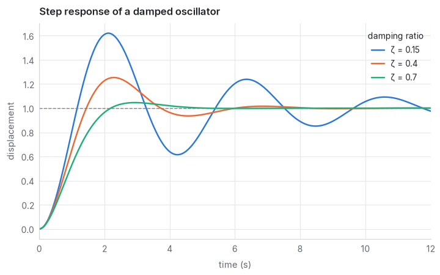
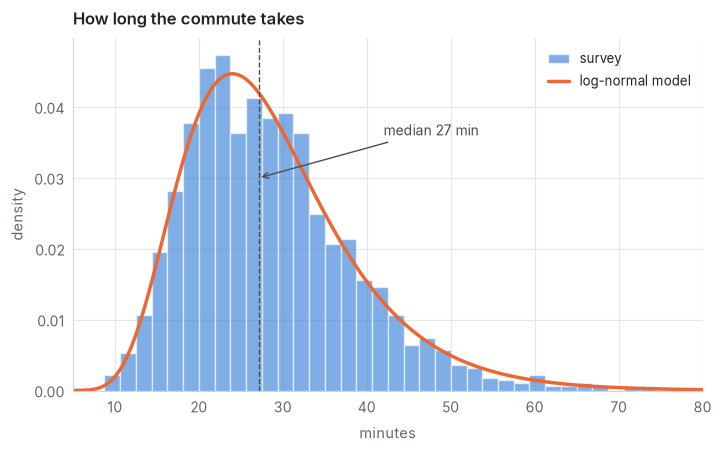
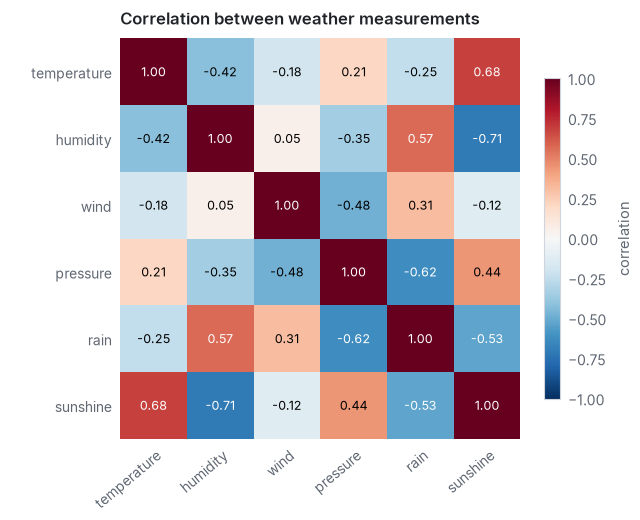
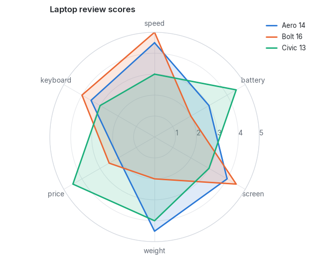
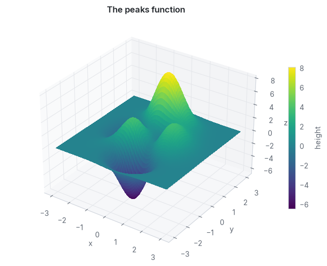
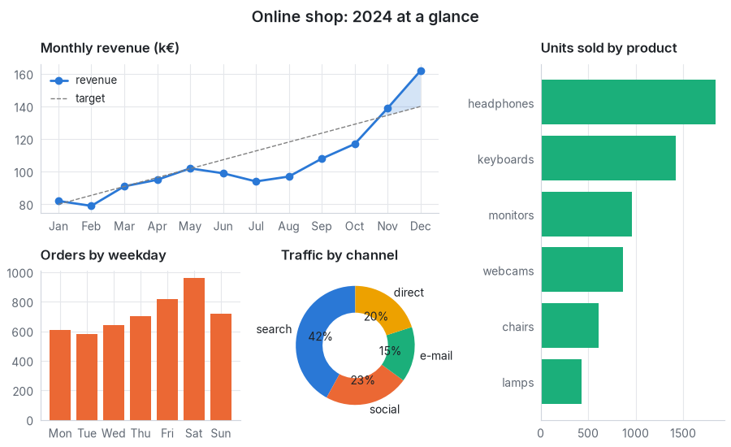
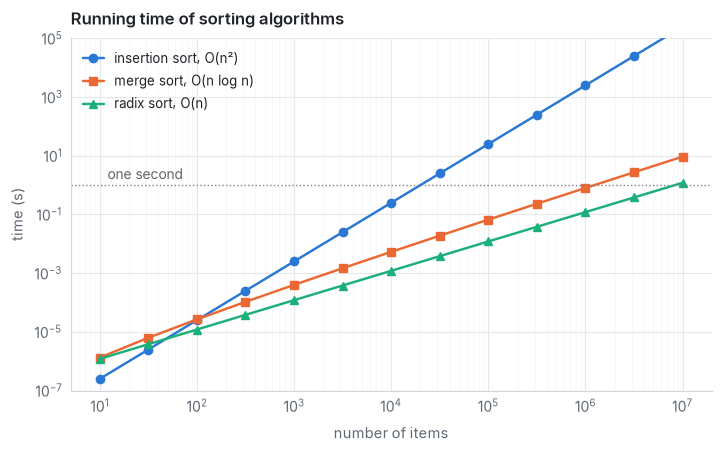
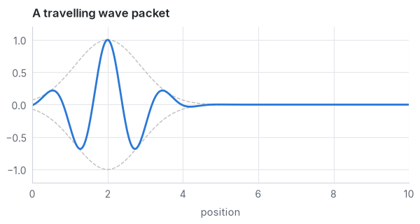

# plt-rs examples

Twenty graphs of the kinds people plot most, each written twice: in Rust
with plt, and in Python with pltrs, plt-rs' Python package, which keeps
matplotlib's syntax (`import pltrs.pyplot as plt`). The two versions of
an example draw the same figure from the same data.

* `rust/` is the `plt-examples` crate, with one binary per graph in
  `src/bin/`.
* `python/` has one script per graph, with the same names.
* `images/` holds what the Rust examples draw. These are the images below.

## The look

The images show plt-rs' modern look, the look plt and pltrs draw in by
default. The Python scripts are ordinary matplotlib code apart from the
import, so they also run under matplotlib once the import names
`matplotlib`, and matplotlib then draws them in its own look.
`cargo xtask examples` gives matplotlib the modern look's style sheet
(`crates/plt/src/style/sheets/plt-modern.mplstyle`) and the Inter font,
so that it draws them in the modern look too.

## Running one example

```sh
cargo run --release -p plt-examples --bin line_plot   # writes line_plot.png here
python examples/python/line_plot.py                   # the same, with pltrs installed
```

Each example saves its figure in the working directory, as `<name>.png`.
The animation saves `animation.gif`.

The examples that need noisy data draw it from a seeded generator, so
every run plots the same points. numpy's generators cannot be reproduced
outside numpy, so both languages use SplitMix64, the generator inside
plt-rs: `plt_examples::Samples` in Rust and `python/samples.py` in Python.

## Running them all

```sh
cargo xtask examples [NAME...]           # render the gallery and compare
cargo xtask examples --check [NAME...]   # check that the gallery is up to date
```

`cargo xtask examples` runs every Rust example and writes its image to
`images/`. It then runs every Python example under real matplotlib from
the reference venv (`.venv`), writing to `target/examples/python-mpl/`.
The runner (`xtask/src/examples/run_matplotlib.py`) answers the scripts'
`pltrs` imports with matplotlib and applies the modern look, so the
examples themselves stay untouched. A table then gives, for each
example, the RMS difference between the Rust image and matplotlib's, on
the 0 to 255 scale of the spec's pixel comparisons.

The same command runs the Python examples under pltrs too, writing to
`target/examples/python-pltrs/` and adding a column to the table. It
does so when pltrs can be imported: by the pltrs venv's interpreter
(`.venv-pltrs/bin/python`, or the one `PLTRS_PYTHON` names), with
`python/` on `PYTHONPATH`. Otherwise it says why it skipped pltrs.
pltrs is still growing toward matplotlib's whole API, so its runs are
reported but do not fail `--check` unless `--require-pltrs` is given.

With `--check`, the Rust images go to `target/examples/rust/` instead,
and the command fails when

* an example does not run, in Rust, under matplotlib or under pltrs;
* an image in `images/` is not the one its Rust example draws now;
* this page does not link an example's image or one of its sources;
* `images/` holds an image that belongs to no example;
* the Rust and matplotlib images of an example differ by an RMS above
  1.0, the tolerance of the spec's pixel comparisons.

To add an example, write `rust/src/bin/<name>.rs` and
`python/<name>.py`, run `cargo xtask examples`, and add the example to
the gallery below.

## Gallery

### Line plot with a legend

The step response of a spring-mass system for three damping ratios.



[Rust](rust/src/bin/line_plot.rs) · [Python](python/line_plot.py)

### Scatter plot with a colorbar

The weight and fuel use of 150 cars, coloured by power through a
colormap, the marker size giving the engine size.


[Rust](rust/src/bin/scatter_colorbar.rs) · [Python](python/scatter_colorbar.py)

### Grouped bars with labels

Daily screen time by age group and device, each bar labelled with its
value.


[Rust](rust/src/bin/grouped_bars.rs) · [Python](python/grouped_bars.py)

### Stacked area chart

A country's electricity generation by source, year by year, the top edge
giving the total.


[Rust](rust/src/bin/stacked_area.rs) · [Python](python/stacked_area.py)

### Histogram with a density curve

1500 commute times as a density histogram, against the log-normal
distribution they were drawn from.



[Rust](rust/src/bin/histogram_density.rs) · [Python](python/histogram_density.py)

### Box plots and violin plots

The exam scores of four classes taught four ways, summarised both ways
on a shared axis.


[Rust](rust/src/bin/box_violin.rs) · [Python](python/box_violin.py)

### Donut chart

A household's monthly spending by category, with the total in the hole.


[Rust](rust/src/bin/donut.rs) · [Python](python/donut.py)

### Error bars

The activity of an enzyme and of a heat-stable variant across
temperatures, each point a mean with its standard deviation.


[Rust](rust/src/bin/error_bars.rs) · [Python](python/error_bars.py)

### Annotated heatmap

The correlations between six daily weather measurements, each cell
labelled with its value.



[Rust](rust/src/bin/heatmap.rs) · [Python](python/heatmap.py)

### Contour and filled contour plot

A relief map of two hills and a valley, labelled contour lines drawn over
coloured height bands.


[Rust](rust/src/bin/contours.rs) · [Python](python/contours.py)

### Streamplot

Air flowing past a cylinder, the streamlines coloured by speed.


[Rust](rust/src/bin/streamplot.rs) · [Python](python/streamplot.py)

### Polar axes

A radar chart scoring three laptops on six criteria.



[Rust](rust/src/bin/polar.rs) · [Python](python/polar.py)

### 3-D surface

The "peaks" function as a surface coloured by height, with a colorbar.



[Rust](rust/src/bin/surface_3d.rs) · [Python](python/surface_3d.py)

### Time series with dates

A year of daily visits to a website with its 7-day mean, a campaign
marked, and the concise date formatter on the x axis.


[Rust](rust/src/bin/time_series.rs) · [Python](python/time_series.py)

### Subplot mosaic dashboard

Four views of an online shop's year, laid out by name with
`subplot_mosaic`.



[Rust](rust/src/bin/dashboard.rs) · [Python](python/dashboard.py)

### Log axes

The running time of three sorting algorithms against the input size, on
log-log axes where power laws become straight lines.



[Rust](rust/src/bin/log_axes.rs) · [Python](python/log_axes.py)

### Twin axes

A climate chart with rainfall as bars on the left axis and temperature
as a line on the right one.


[Rust](rust/src/bin/twin_axes.rs) · [Python](python/twin_axes.py)

### Annotations and arrows

A year of a share price with its high, its sharpest fall and a summary
box pointed out.


[Rust](rust/src/bin/annotations.rs) · [Python](python/annotations.py)

### Mathtext

Normal distributions labelled with TeX-like formulas, which plt-rs
typesets itself, without TeX.


[Rust](rust/src/bin/mathtext.rs) · [Python](python/mathtext.py)

### Animation saved as a GIF

A wave packet travelling along a string, 30 frames saved as an animated
GIF.



[Rust](rust/src/bin/animation.rs) · [Python](python/animation.py)
