# pltrs examples

This directory holds twenty common graphs, each in Rust for pltrs (Rust)
and in Python for pltrs (Python). Both versions draw the same figure from
the same data. The Python version uses matplotlib's syntax (`import
pltrs.pyplot as plt`).

* `rust/` is the `pltrs-examples` crate, with one binary per graph in
  `src/bin/` and matplotlib's tutorials in `tutorials/`. See
  [Tutorials](#tutorials).
* `python/` has one script per graph, with the same names.
* `images/` holds the images of the Rust examples, which the gallery
  below shows.

## The look

The images show the modern look, the default of pltrs (Rust) and pltrs
(Python). The Python scripts are matplotlib code except for the import.
If the import names `matplotlib`, matplotlib runs them in the matplotlib
look. `cargo xtask examples` gives matplotlib the Inter font and the
style sheet of the modern look
(`crates/pltrs/src/style/sheets/pltrs-modern.mplstyle`).

If you set `PLTRS_LOOK=matplotlib`, both versions draw the images that
matplotlib draws from the Python scripts with its default settings.

## Run one example

```sh
cargo run --release -p pltrs-examples --bin line_plot  # writes line_plot.png here
python examples/python/line_plot.py                    # the same, with pltrs installed
```

Each example saves its figure as `<name>.png` in the working directory.
The animation saves `animation.gif`.

Noisy data comes from a seeded generator, so every run plots the same
points. Only numpy can reproduce numpy's generators. Thus both languages
use SplitMix64, the generator of pltrs: `pltrs_examples::Samples` in
Rust and `python/samples.py` in Python.

## Run all examples

```sh
cargo xtask examples [NAME...]           # render the gallery and compare
cargo xtask examples --check [NAME...]   # check that the gallery is up to date
```

`cargo xtask examples` does these steps:

1. It runs every Rust example and writes its image to `images/`.
2. It runs every Python example under matplotlib from `.venv` and
   writes to `target/examples/python-mpl/`.
3. If it can import pltrs, it runs every Python example under pltrs and
   writes to `target/examples/python-pltrs/`. Otherwise it tells you why
   it skipped pltrs.
4. It prints the RMS difference between the Rust image and each Python
   image, on the 0 to 255 scale of the spec's pixel comparisons.

The runner `xtask/src/examples/run_matplotlib.py` gives matplotlib to
the `pltrs` imports and applies the modern look, so the examples do not
change. The pltrs runs use `.venv-pltrs/bin/python`, or the interpreter
that `PLTRS_PYTHON` names, with `python/` on `PYTHONPATH`.

With `--check`, the command writes the Rust images to
`target/examples/rust/` and fails in these cases:

* An example does not run in Rust, under matplotlib or under pltrs.
* An image in `images/` differs from what its Rust example draws now.
* This page does not link the image or a source of an example.
* `images/` holds an image that belongs to no example.
* The Rust and matplotlib images of an example differ by an RMS above
  1.0, the tolerance of the spec's pixel comparisons.

A failed pltrs run fails `--check` only with `--require-pltrs`, so the
check needs no build of pltrs (Python).

To add an example, write `rust/src/bin/<name>.rs` and
`python/<name>.py`, run `cargo xtask examples`, and add the example to
the gallery below.

## Tutorials

`rust/tutorials/` has one program per matplotlib tutorial. It shows a
matplotlib user how to do the tutorial in pltrs (Rust). Each section
names the matplotlib calls that it replaces. The programs are cargo
examples of the `pltrs-examples` crate:

```sh
cargo run -p pltrs-examples --example quick_start   # writes its images here
```

`cargo xtask examples` runs every tutorial in a separate directory under
`target/examples/tutorials/`, and fails if one fails. The name of a
tutorial runs only that tutorial. To add a tutorial, write
`rust/tutorials/<name>.rs` and add an `[[example]]` entry to
`rust/Cargo.toml`.

| tutorial | matplotlib's tutorials |
|---|---|
| [quick_start](rust/tutorials/quick_start.rs) | Quick start guide: the object-oriented and the pyplot style, styling artists, labels, scales, extra axes, colour-mapped data |
| [styles_and_rcparams](rust/tutorials/styles_and_rcparams.rs) | Customizing Matplotlib with style sheets and rcParams |
| [colormaps_and_norms](rust/tutorials/colormaps_and_norms.rs) | Choosing Colormaps, Creating Colormaps, Colormap normalization |
| [text_and_mathtext](rust/tutorials/text_and_mathtext.rs) | Text in Matplotlib, Text properties and layout, Writing mathematical expressions |
| [annotation_guide](rust/tutorials/annotation_guide.rs) | Annotations: coordinate systems, arrow and connection styles, anchored text |
| [layouts](rust/tutorials/layouts.rs) | Arranging multiple Axes, Constrained layout guide, Tight layout guide, subfigures, insets |
| [three_d](rust/tutorials/three_d.rs) | 3D plotting (`mpl_toolkits.mplot3d`) |
| [animation_guide](rust/tutorials/animation_guide.rs) | Animations using Matplotlib: `FuncAnimation`, blitting, frame lists, movie writers |
| [interactive](rust/tutorials/interactive.rs) | Interactive figures, Event handling and picking, widgets (`--show` opens a window) |
| [saving](rust/tutorials/saving.rs) | Saving figures in every format, with `savefig`'s options and `PdfPages` |

## Gallery

### Line plot with a legend

The step response of a spring-mass system for three damping ratios.


[Rust](rust/src/bin/line_plot.rs) · [Python](python/line_plot.py)

### Scatter plot with a colorbar

The weight and fuel use of 150 cars. Color shows power, and marker size
shows engine size.

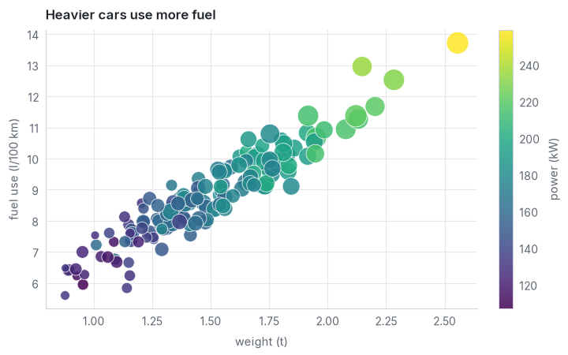

[Rust](rust/src/bin/scatter_colorbar.rs) · [Python](python/scatter_colorbar.py)

### Grouped bars with labels

Daily screen time by age group and device, with a value label on each
bar.

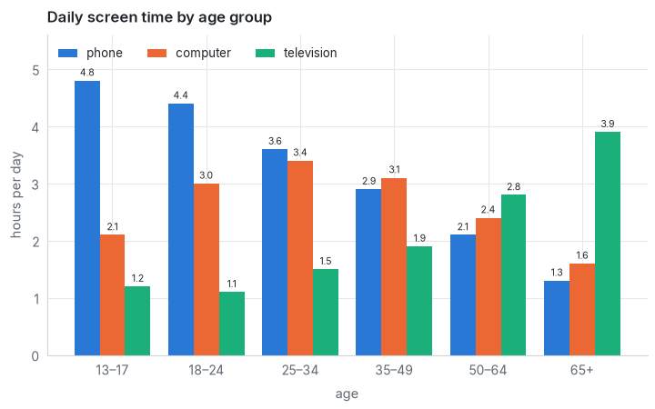

[Rust](rust/src/bin/grouped_bars.rs) · [Python](python/grouped_bars.py)

### Stacked area chart

The electricity generation of a country by source and year. The top
edge is the total.

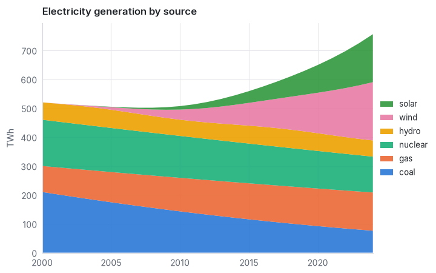

[Rust](rust/src/bin/stacked_area.rs) · [Python](python/stacked_area.py)

### Histogram with a density curve

A density histogram of 1500 commute times, with the log-normal
distribution that the times come from.


[Rust](rust/src/bin/histogram_density.rs) · [Python](python/histogram_density.py)

### Box plots and violin plots

The exam scores of four classes with four teaching methods, as box
plots and violin plots on a shared axis.

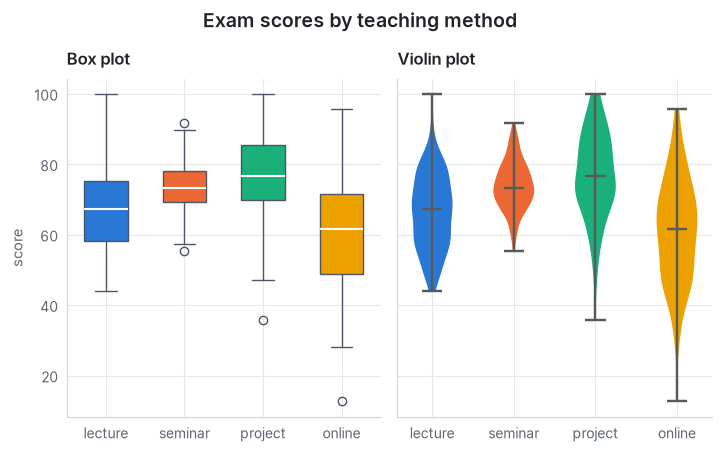

[Rust](rust/src/bin/box_violin.rs) · [Python](python/box_violin.py)

### Donut chart

The monthly spending of a household by category, with the total in the
hole.

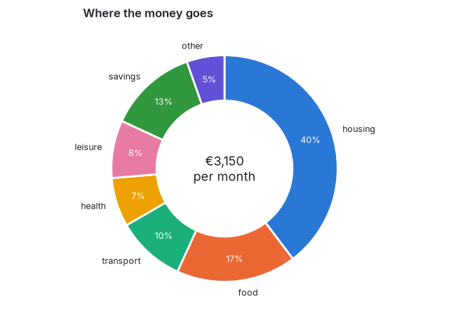

[Rust](rust/src/bin/donut.rs) · [Python](python/donut.py)

### Error bars

The activity of an enzyme and of a heat-stable variant at different
temperatures. Each point is a mean with its standard deviation.

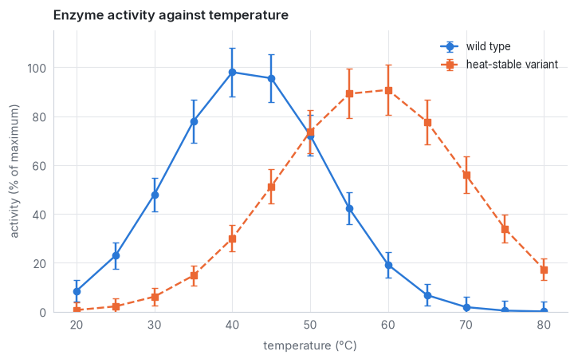

[Rust](rust/src/bin/error_bars.rs) · [Python](python/error_bars.py)

### Annotated heatmap

The correlations between six daily weather measurements, with a value
label in each cell.


[Rust](rust/src/bin/heatmap.rs) · [Python](python/heatmap.py)

### Contour and filled contour plot

A relief map of two hills and a valley. Labeled contour lines are on top
of colored height bands.

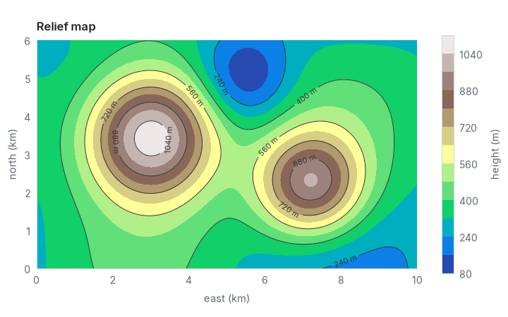

[Rust](rust/src/bin/contours.rs) · [Python](python/contours.py)

### Streamplot

Air that flows past a cylinder, with streamlines colored by speed.

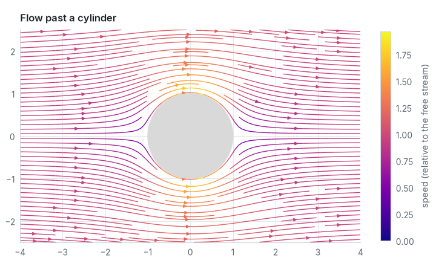

[Rust](rust/src/bin/streamplot.rs) · [Python](python/streamplot.py)

### Polar axes

A radar chart that scores three laptops on six criteria.


[Rust](rust/src/bin/polar.rs) · [Python](python/polar.py)

### 3-D surface

The "peaks" function as a surface colored by height, with a colorbar.


[Rust](rust/src/bin/surface_3d.rs) · [Python](python/surface_3d.py)

### Time series with dates

Daily visits to a website for a year, with the 7-day mean, a marked
campaign and the concise date formatter on the x axis.

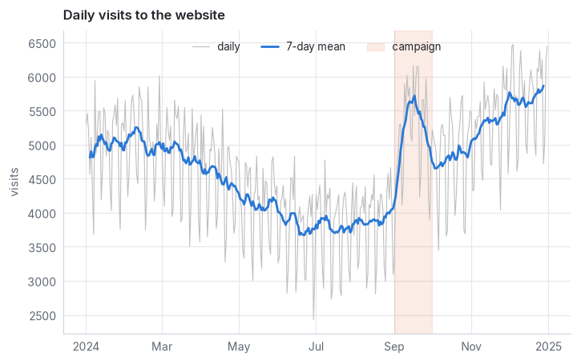

[Rust](rust/src/bin/time_series.rs) · [Python](python/time_series.py)

### Subplot mosaic dashboard

Four views of the year of an online shop. `subplot_mosaic` places the
views by name.


[Rust](rust/src/bin/dashboard.rs) · [Python](python/dashboard.py)

### Log axes

The running time of three sorting algorithms by input size. On log-log
axes, power laws are straight lines.


[Rust](rust/src/bin/log_axes.rs) · [Python](python/log_axes.py)

### Twin axes

A climate chart with rainfall as bars on the left axis and temperature
as a line on the right axis.

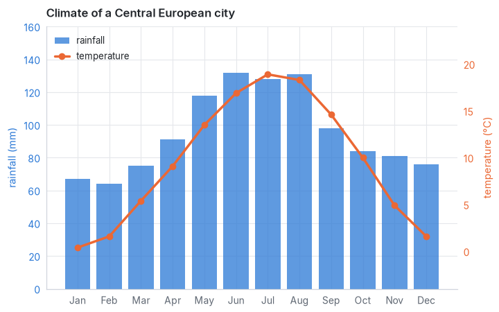

[Rust](rust/src/bin/twin_axes.rs) · [Python](python/twin_axes.py)

### Annotations and arrows

A year of a share price, with arrows to its high and its sharpest fall,
and a summary box.

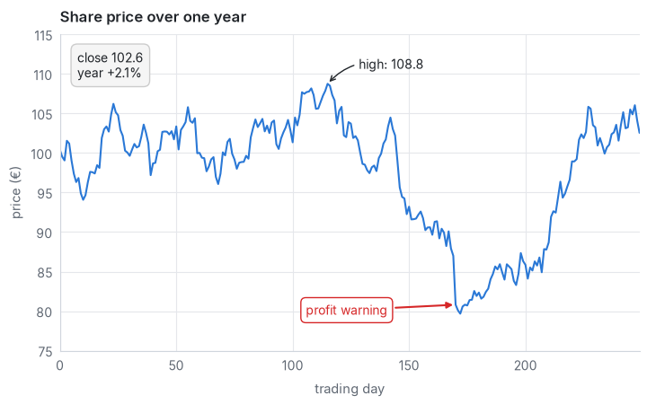

[Rust](rust/src/bin/annotations.rs) · [Python](python/annotations.py)

### Mathtext

Normal distributions labeled with TeX-like formulas, which pltrs
typesets without TeX.

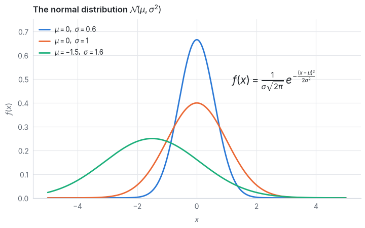

[Rust](rust/src/bin/mathtext.rs) · [Python](python/mathtext.py)

### Animation saved as a GIF

A wave packet that travels along a string, saved as an animated GIF of
30 frames.


[Rust](rust/src/bin/animation.rs) · [Python](python/animation.py)
